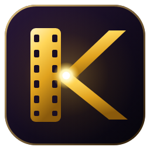
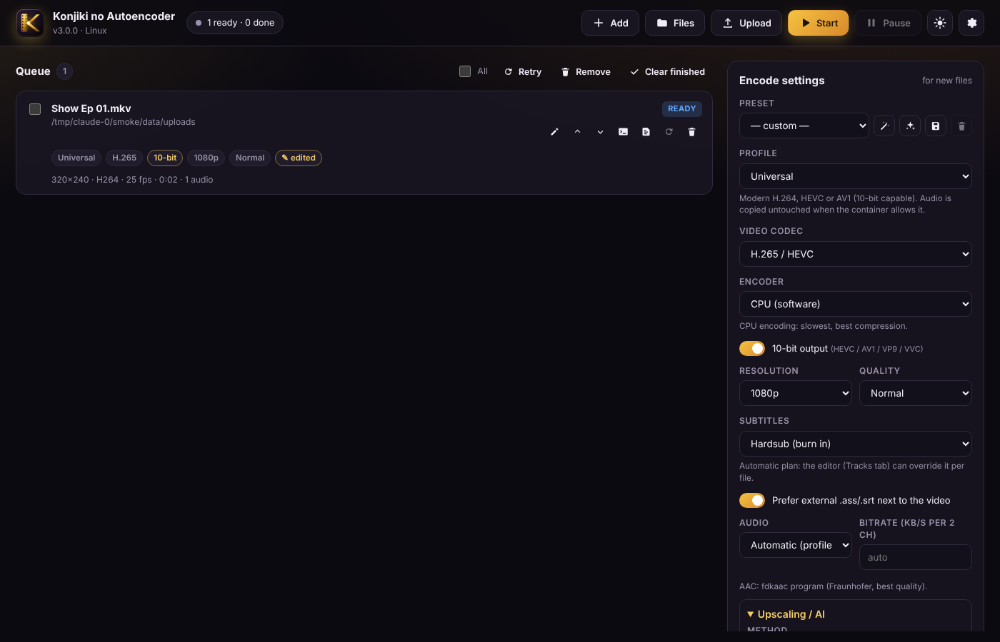
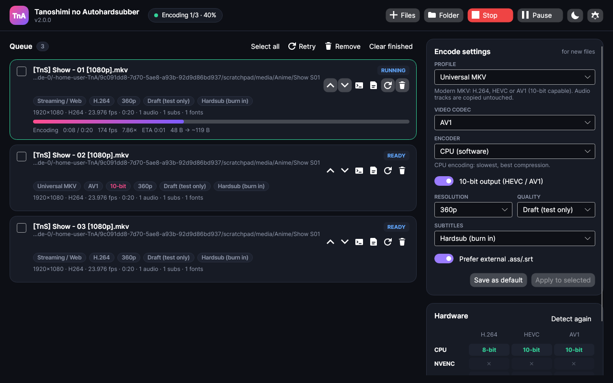
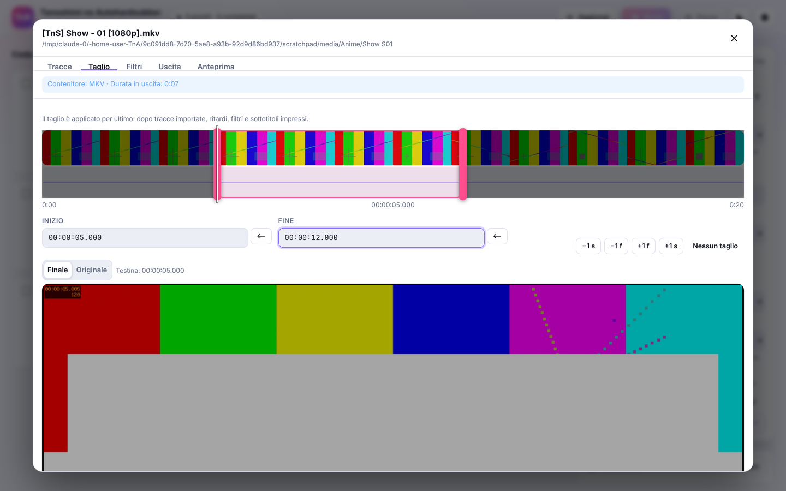
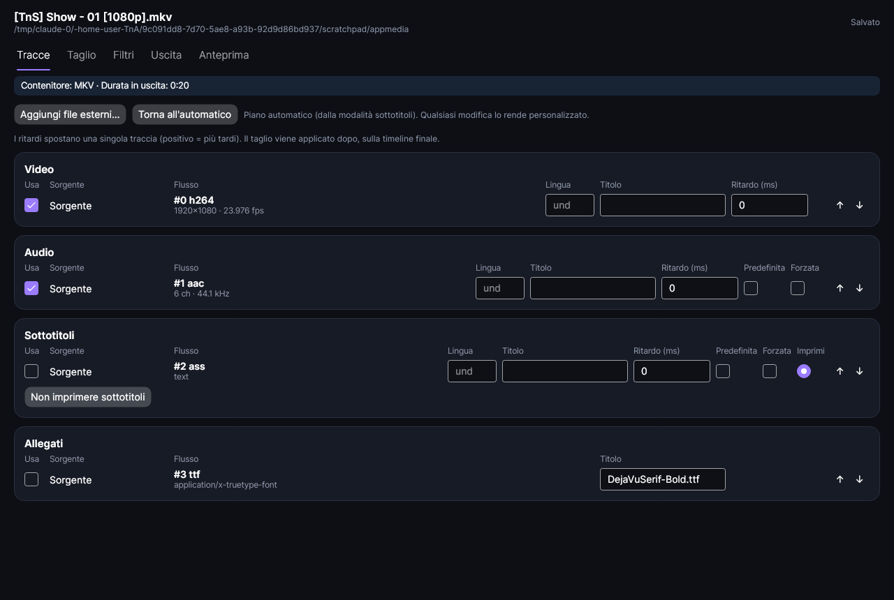
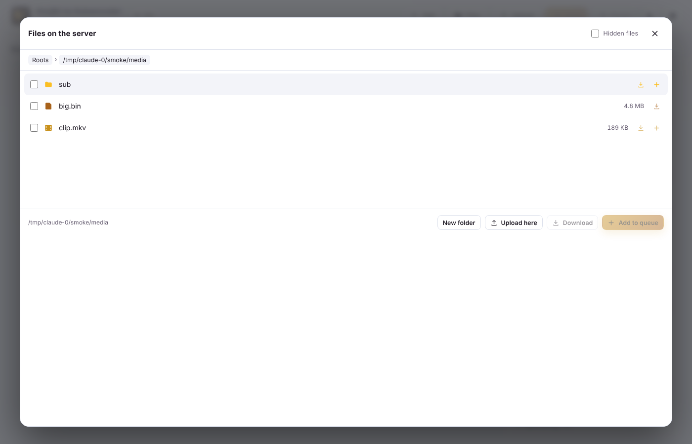
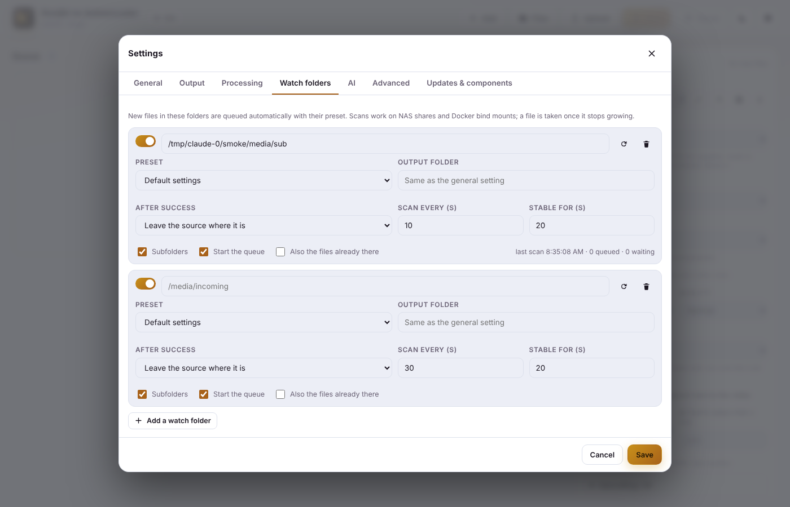
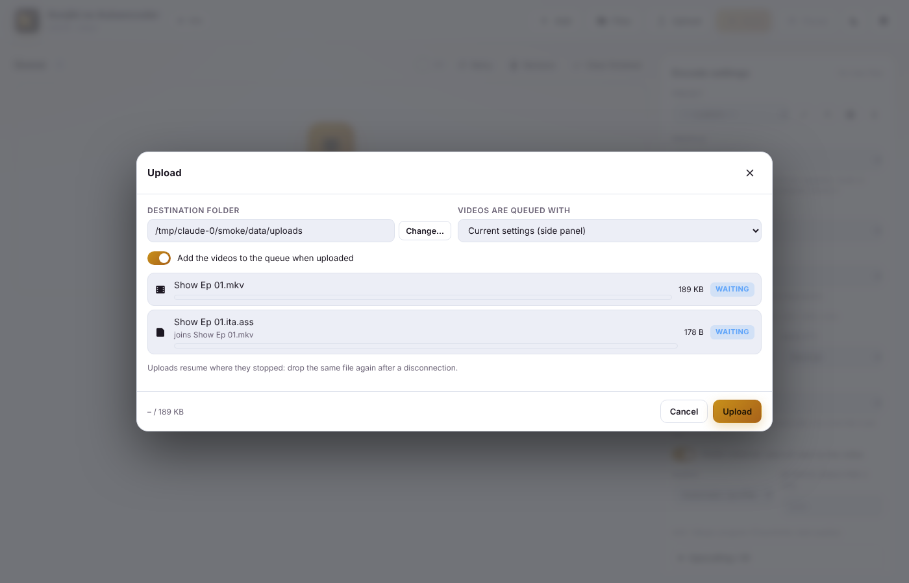
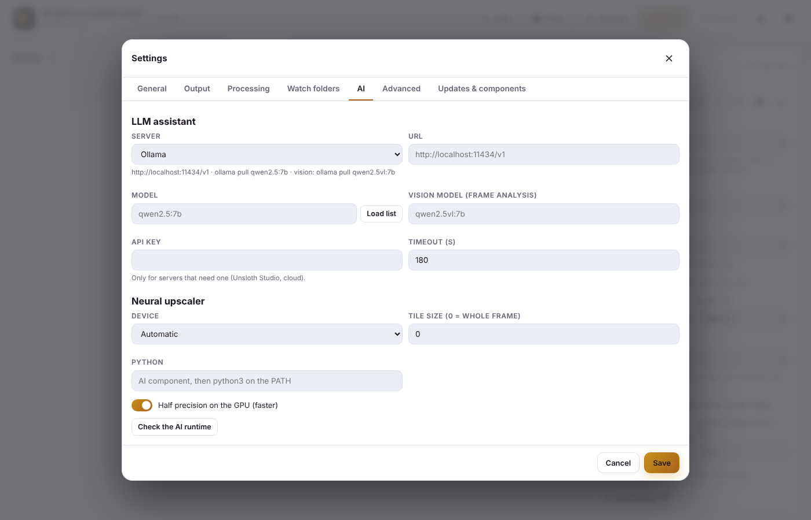

<p align="center"></p>

# KnA - Konjiki no Autoencoder 3.1

[English](README.md) · **Italiano**

Encoder e hardsubber quasi automatico by KonjikiNoYami, per **.NET 10**.

Trascina episodi, cartelle, **Blu-ray (BDMV / ISO) o DVD**, scegli un profilo o un preset. KnA trova i sottotitoli giusti, estrae i font,
imprime i sottotitoli con libass e codifica su **CPU o GPU** (NVENC, Quick Sync, AMF, VideoToolbox, VA-API, **Vulkan**):
H.264, HEVC, AV1, VP9, VVC, MPEG-2 e i codec professionali **ProRes, DNxHR, CineForm, FFV1, Ut Video, FFVHuff, JPEG 2000, v210**,
con **HDR10 / HDR10+ / Dolby Vision**, codifica a segmenti riprendibile, **upscaling su GPU o con modelli neurali** e un **assistente LLM** locale.

### Novità della 3.1
- **La scheda Tracce elenca tutto** (audio compreso, anche in Demux) e permette di **copiare o convertire ogni traccia** direttamente dalla lista.
- **Allegati e capitoli** si aggiungono, rimuovono e modificano per ogni file.
- **Taglio a più segmenti**: uniti in un unico file, oppure divisi in un elemento in coda per segmento.
- **Runtime AI senza installare Python**: se serve viene scaricato un Python portabile; la build CUDA di PyTorch si adatta al driver.

Tutte le modifiche: [CHANGELOG.md](CHANGELOG.md).

### Novità della 3.0
- **Nuova icona** (una K dorata: l'asta è una pellicola, le diagonali convergono nel "collo di bottiglia" di un autoencoder).
- **Codec professionali e lossless**, scelta del **codec audio** (AAC, HE-AAC, Opus, FLAC, ALAC, PCM, AC-3, E-AC-3, TrueHD, DTS…).
- **Il miglior AAC senza chiedere nulla**: libfdk_aac → AudioToolbox → programma **fdkaac** incluso → AAC di FFmpeg.
- **Build FFmpeg personalizzate**: ogni lavoro usa la build che ha i suoi encoder; l'FFmpeg scaricato è quello del **ramo di release più recente**.
- **Errore chiaro se la GPU scelta non ha l'encoder** (o non ha superato il test), invece di un ripiego silenzioso o di un errore a metà.
- **Blu-ray / DVD / ISO**: un lavoro per ogni titolo (episodio), lingue delle tracce lette dalla playlist.
- **Web**: tutto il file system (o le radici scelte), **file manager con download** (anche cartelle in ZIP), **upload riprendibili**, **cartelle monitorate per preset**.
- **Docker solo con bind mount**, nessun volume.
- **Drag & drop intelligente** su desktop e web.
- **AI**: assistente con Ollama, LM Studio, Unsloth Studio, llama.cpp, vLLM…; upscaling Anime4K / FSRCNNX su GPU e Real-ESRGAN via PyTorch.

| Edizione web (Docker / Proxmox / qualsiasi browser) | Edizione desktop (Windows / macOS / Linux) |
|---|---|
|  |  |
|  |  |
|  |  |
|  |  |

## Due interfacce, un solo motore

| | **Edizione web** `src/KnA.Server` | **Edizione desktop** `src/KnA.App` |
|---|---|---|
| Gira su | Docker, LXC/VM Proxmox, NAS o in locale | Windows, macOS (anche Apple Silicon), Linux |
| Interfaccia | Pagina web responsive (anche da telefono), avanzamento in diretta via SSE | Finestra Avalonia nativa, drag & drop, Ctrl+V, Invia a |
| File | Sfogliati sul server (radici multimediali) | Dischi locali |

Entrambe usano **`KnA.Core`**, che si occupa di analisi dei file, costruzione dei comandi, coda, anteprime, preset, aggiornamenti e log.
L'interfaccia è in **italiano** se il sistema (o il browser) è in italiano, altrimenti in **inglese**; si può forzare da *Impostazioni → Generale*.

## Funzioni

### Codec

| Gruppo | Codec | Note |
|---|---|---|
| Distribuzione | H.264, HEVC, AV1, VP9, VVC (H.266), MPEG-2, XviD | 10 bit per HEVC / AV1 / VP9 / VVC |
| Professionali (profilo *Professionale / Lossless*) | ProRes (Proxy…4444 XQ), DNxHR (LB…444), CineForm | MOV / MXF / MKV / AVI, profilo automatico dalla qualità o scelto a mano, croma 4:2:2 / 4:4:4 |
| Lossless | FFV1 (v3, slice CRC), Ut Video, FFVHuff, JPEG 2000, v210 non compresso | profondità di bit della sorgente o scelta (8–16) |
| Audio | AAC, HE-AAC, Opus, MP3, Vorbis, AC-3, E-AC-3, FLAC, ALAC, WavPack, TrueHD, DTS, PCM 16/24/32f | *Automatico* = come il profilo, copia quando possibile; bitrate per coppia di canali |

**Encoder alternativi**: per ogni codec/backend KnA prova più encoder in ordine (AV1 su CPU: SVT-AV1 → libaom → rav1e; JPEG 2000: OpenJPEG → nativo)
e usa il primo che supera una **codifica di prova reale**.

**GPU** (tutte verificate con una codifica di prova):

| Backend | Codec |
|---|---|
| NVIDIA NVENC | H.264, HEVC, AV1 (RTX 40/50) |
| Intel Quick Sync | H.264, HEVC, AV1, VP9, MPEG-2 |
| AMD AMF | H.264, HEVC, AV1 |
| VA-API (Linux) | H.264, HEVC, AV1, VP9, MPEG-2 |
| Apple VideoToolbox | H.264, HEVC, **ProRes** |
| **Vulkan** (qualsiasi GPU, FFmpeg 7.1+ / 8.0+ / 8.1+) | H.264, HEVC, AV1, **FFV1**, ProRes |

Se il backend scelto non ha un encoder per quel codec, o l'encoder non ha superato il test su quel computer, il lavoro viene segnalato
**in errore prima di iniziare**, con l'elenco dei backend disponibili.

**AAC di qualità senza configurare nulla**: libfdk_aac non può essere distribuito dentro un FFmpeg GPL, quindi KnA usa, nell'ordine,
`libfdk_aac` (se una tua build personalizzata ce l'ha) → `aac_at` (AudioToolbox su macOS) → il programma **fdkaac**
(Fraunhofer FDK AAC + frontend Zlib, distribuibile da solo: incluso nei pacchetti di KnA e nell'immagine Docker, installabile dai Componenti;
KnA lo usa come processo separato, ffmpeg → WAV → fdkaac) → l'AAC interno di FFmpeg. Anche l'**HE-AAC** passa da qui.

**FFmpeg personalizzati**: in *Impostazioni → Avanzate* puoi elencare altre build (es. una compilata con libfdk_aac, o una nightly con gli encoder Vulkan)
e i percorsi di ffprobe, fdkaac, dovi_tool, hdr10plus_tool, vspipe, scxvid. Il rilevamento prova tutte le build; ogni lavoro usa quella che ha
il suo encoder (prima le personalizzate, preferendo quella con libfdk_aac). Il component manager scarica la **build BtbN del ramo di release più recente**
(es. 9.0) o, se lo scegli, master.

### Blu-ray, DVD e immagini ISO
- Cartelle **BDMV** (o la cartella che le contiene), cartelle **VIDEO_TS** e file **.iso** si aggiungono come qualsiasi video.
- Ogni **titolo lungo come un episodio** diventa un lavoro (`Disco - playlist 00002`), oppure solo il titolo principale; le playlist duplicate vengono scartate.
- Lettura: protocollo `bluray:` di FFmpeg (libbluray, anche ISO) e demuxer `dvdvideo` (FFmpeg 7+, anche ISO). Se mancano, KnA legge
  **da solo** le cartelle: parser MPLS/CLPI per i Blu-ray (le clip vengono unite con i punti di inizio/fine giusti) e IFO per i DVD.
- Le **lingue** delle tracce dei Blu-ray vengono lette dalla playlist (il flusso TS non le contiene).

### Upscaling e AI
| Metodo | Dove gira | Per cosa |
|---|---|---|
| Standard (Lanczos) | CPU | riduce soltanto, come prima |
| EWA Lanczos (libplacebo) | qualsiasi GPU Vulkan | ingrandimento di qualità |
| **Anime4K** modi A/B/C/A+A | GPU (libplacebo) | anime, in tempo quasi reale |
| **FSRCNNX** | GPU (libplacebo) | rete neurale piccola, anche live action |
| **Neurale**: Real-ESRGAN, AnimeVideo v3, qualsiasi modello *spandrel* (.pth/.safetensors) o .onnx | PyTorch su CUDA (RTX 50 inclusa), ROCm, Apple MPS, CPU | qualità massima |

Gli shader e il **runtime AI** (ambiente Python privato con la build PyTorch giusta per la tua GPU) si installano da *Componenti*.
**Python non serve**: se nel sistema non ce n'è uno adatto (3.11–3.14; lo stub del Microsoft Store non conta) KnA scarica un **Python portabile**
(python-build-standalone, checksum verificato) nella sua cartella dati. PyTorch arriva da download.pytorch.org con la **build CUDA più recente supportata
dal tuo driver** (letta da `nvidia-smi`; le RTX 50 / Blackwell richiedono CUDA 12.8+), ROCm su AMD/Linux, la build standard su macOS (MPS), CPU negli altri casi.
Il componente mostra la versione di PyTorch installata e la più recente (PyPI) e *Aggiorna* la porta all'ultima; un ambiente creato con un Python troppo
vecchio per l'attuale PyTorch viene ricreato. I modelli ufficiali Real-ESRGAN
si scaricano al primo uso. Il sidecar `ai/kna_upscale.py` decodifica la sorgente con i filtri di KnA, esegue il modello e passa i fotogrammi RGB a 16 bit
all'FFmpeg che codifica: sottotitoli impressi, audio, capitoli, codifica a segmenti e anteprime funzionano come sempre.

**Assistente LLM** (*Impostazioni → AI*): Ollama, LM Studio, **Unsloth Studio**, llama.cpp, vLLM, LocalAI, Jan o un servizio cloud compatibile OpenAI.
- *Chiedi*: "MP4 leggero per Telegram sotto i 2 GB, 720p, sottotitoli impressi" → impostazioni proposte.
- *Analizza i fotogrammi*: un modello **vision** (es. `qwen2.5vl`, `gemma3`, `llava`) guarda alcuni fotogrammi e propone filtri e upscaler.

L'LLM **non codifica il video** (non è quello che sa fare): sceglie le impostazioni. La risposta è un JSON vincolato alle opzioni di KnA,
validato campo per campo e confrontato con il rilevamento hardware; non cambia nulla finché non premi *Usa queste impostazioni*.

### Edizione web: file, upload, download, cartelle monitorate
- **Tutto il file system** del sistema su cui gira (tutti i dischi su Windows, `/` altrove) oppure solo le radici di `KNA_MEDIA_ROOTS`,
  più radici in **sola lettura** (`KNA_READONLY_ROOTS`). Senza password KnA lo segnala nel log.
- **File manager**: sfoglia, crea cartelle, **scarica** file (riprendibili) o cartelle intere (**ZIP** in streaming), aggiungi alla coda.
- **Upload** dal browser a blocchi da 16 MB, **riprendibili** dopo una disconnessione, direttamente nella cartella di destinazione;
  i video vanno in coda con il preset scelto, sottotitoli/audio/font si agganciano al loro video.
- **Cartelle monitorate**: ogni cartella ha il suo **preset**, cartella di uscita, sottocartelle, avvio automatico della coda e cosa fare dopo
  (lasciare, spostare in `_done`, eliminare). La scansione funziona anche su NAS e bind mount; un file viene preso quando smette di crescere.
- Il risultato di ogni lavoro si scarica dal pulsante ⬇ della coda.

### Drag & drop intelligente
Desktop e web: video, script, dischi e cartelle vanno in coda; **sottotitoli, audio e font** si agganciano al lavoro su cui li rilasci
o al video con lo stesso nome (`Ep01.ita.ass` → `Ep01.mkv`; in hardsub il sottotitolo diventa quello impresso); i **preset** `.json` vengono importati;
duplicati, file non supportati e cartelle enormi vengono mostrati prima di procedere.

### Codifica
- **Profili**: Universale (H.264/HEVC/AV1/VP9/VVC/MPEG-2), Streaming/Web, **Professionale / Lossless**, Blu-ray AAC / AC-3, Workraw, XviD+MP3,
  Remux→MP4, Remux→MKV, **Immagini** (PNG / JPEG / TIFF / WebP / BMP), **Demux** e keyframe per Aegisub.

- **Codifica a segmenti** (stile av1an): il video viene diviso sui keyframe, i segmenti vengono codificati in parallelo
  e un lavoro fermato **riparte dall'ultimo segmento completato**. Ideale per gli encoder lenti su CPU (x265, SVT-AV1).
- **HDR**: l'HDR10 viene mantenuto (metadati mastering display e luminanza passati all'encoder) oppure **convertito in SDR**
  (libplacebo se disponibile, altrimenti zscale + Hable). **Dolby Vision** (RPU tramite `dovi_tool`) e **HDR10+**
  (tramite `hdr10plus_tool`) vengono conservati ricodificando in HEVC con x265; KnA spiega quando non è possibile (taglio, ritaglio, cambio di frame rate, encoder GPU).
- **Contenitori**: MKV, MP4, MOV, WebM, AVI, TS, con controllo di compatibilità con i codec scelti
  (un AVI non può contenere HEVC, gli allegati richiedono Matroska, e così via).

### Editor per file
Ogni file in coda ha un editor (✎) con cinque schede:

1. **Tracce**: vengono elencati **tutti** i flussi del file (video, audio, sottotitoli, allegati), in ogni profilo, Demux compreso;
   usali, rimuovili o sostituiscili e aggiungi **audio, sottotitoli, font e altri file esterni**.
   I file MKV / MKA / MP4 vengono analizzati e spunti i flussi da importare. Ogni traccia ha lingua, titolo,
   flag predefinita/forzata e un proprio **ritardo** (video, audio e sottotitoli). Un sottotitolo può essere impresso.
   - **Uscita per traccia**: copia o converti ogni flusso direttamente dalla lista: video *copia* (senza ricodifica, filtri esclusi),
     audio *copia* oppure AAC / HE-AAC / Opus / AC-3 / E-AC-3 / FLAC / … con il proprio bitrate, sottotitoli *copia* oppure SRT / ASS / WebVTT / mov_text
     (verificato con il contenitore: i sottotitoli bitmap non possono diventare testo).
   - **Allegati**: togli la spunta agli allegati del file per escluderli, **aggiungi** font, copertine o qualsiasi altro file (✕ li rimuove).
   - **Capitoli**: elencati con tempo e titolo; aggiungi, rimuovi, rinomina, sposta, "ogni 5 minuti", oppure torna ai capitoli del file.
     I tempi sono sulla timeline originale: i tagli li spostano automaticamente.
   - In **Demux** tracce, allegati e capitoli spuntati sono i file che vengono estratti.
2. **Taglio**: timeline visiva con miniature e forma d'onda dell'audio, maniglie trascinabili, spostamenti al fotogramma.
   **Più segmenti**: aggiungi quante parti vuoi tenere (*Aggiungi segmento alla testina*), poi **uniscile** in un unico file
   (ogni parte viene prodotta con le stesse impostazioni e le parti vengono unite senza ricodifica; i capitoli seguono) oppure
   **crea N elementi in coda**, uno per segmento (uscite chiamate "… - parte N").
   **Il taglio è sempre applicato per ultimo**, dopo tracce importate, ritardi, filtri e sottotitoli impressi: un sottotitolo
   importato con un ritardo resta sincronizzato anche dopo il taglio.
3. **Filtri**: orientamento (i video ruotati dei telefoni vengono riconosciuti; rotazione e specchiatura si possono correggere),
   deinterlacciamento, ritaglio (con rilevamento delle bande nere), riduzione rumore, deband, nitidezza, frame rate, filtri FFmpeg personalizzati;
   guadagno audio, normalizzazione del volume (EBU R128), riduzione a stereo, frequenza di campionamento.
   Come frameserver si possono scegliere **VapourSynth** e **AviSynth+**, con modelli pronti; è supportato anche l'audio prodotto dallo script.
4. **Uscita**: tutte le impostazioni del profilo, contenitore, modalità HDR, codifica a segmenti, opzioni immagini o demux (i flussi si scelgono in *Tracce*), destinazione,
   "salva come preset" e il comando FFmpeg esatto.
5. **Anteprima**: il fotogramma finale (filtri, sottotitoli impressi, conversione HDR) in qualsiasi punto, più una clip di 6 secondi del risultato.
   Tutte le anteprime (fotogrammi, miniature, forma d'onda, rilevamento bande nere, clip) funzionano anche con sorgenti VapourSynth e AviSynth.

### Preset
Preset integrati, preset personali salvati da qualsiasi file e una **procedura guidata** che fa qualche domanda semplice
(a cosa serve, compatibilità o dimensione, velocità o compressione, sottotitoli, audio) e sceglie una GPU funzionante se chiedi velocità.

### Robustezza
- **Transport stream** (`.ts`, `.m2ts`…): finestra di analisi più ampia, timestamp rigenerati, pacchetti corrotti e flussi
  dati/teletext sconosciuti ignorati: i metadati strani delle trasmissioni non mandano più in errore FFmpeg.
- Controllo dello spazio libero e dei permessi di scrittura prima di iniziare, watchdog per i processi FFmpeg bloccati, log dei crash,
  rotazione dei log, coda che sopravvive ai riavvii, pulizia dei file temporanei.
- **Non sovrascrive mai nulla**: i nomi seguono un modello (`{name} [{label}]` di default) e si aggiunge un contatore se il nome esiste già.

### Aggiornamenti
- *Impostazioni → Aggiornamenti e componenti* controlla le **release GitHub di questo repository** per una nuova versione di KnA
  (l'app desktop la scarica e la installa; il server mostra come aggiornare il container o il servizio).
- **FFmpeg, ffprobe, dovi_tool e hdr10plus_tool** si installano o aggiornano dalle loro pagine di release ufficiali
  (build FFmpeg di BtbN su Windows/Linux, Homebrew su macOS).
- **Runtime AI**: Python portabile quando serve, PyTorch (CUDA adatto al driver / ROCm / MPS / CPU), spandrel; controllo aggiornamenti su PyPI.

### Integrazione col desktop
- **"Invia a" di Windows**: *Impostazioni → Uscita* aggiunge la voce "KnA" più una voce per ogni preset scelto (aggiunge i file con
  quel preset e avvia la coda). Più file inviati insieme finiscono nella stessa finestra.
- **Linux**: "Apri con", script di Nautilus e menu di servizio di Dolphin con le stesse voci.
- Riga di comando: `KnA [--preset "Nome"] [--start] file-o-cartelle…`

## Avvio rapido

### Download (portable)

Scarica l'ultimo pacchetto da **[Releases](https://github.com/KonjikiNoYami1991/KnA/releases/latest)**:

| Sistema | Pacchetto portable | Avvio |
|---|---|---|
| Windows x64 / Arm | `KnA-portable-win-x64.zip` · `KnA-portable-win-arm64.zip` | estrai dove vuoi (anche su chiavetta), apri `KnA\KnA.exe` |
| Linux x64 / arm64 | `KnA-portable-linux-x64.tar.gz` · `KnA-portable-linux-arm64.tar.gz` | `tar xzf KnA-portable-*.tar.gz && ./KnA/KnA` |
| macOS | `KnA-macOS-osx-arm64.app.zip` · `KnA-macOS-osx-x64.app.zip` | estrai e sposta `KnA.app` in Applicazioni |

I pacchetti portable non richiedono installazioni (.NET è incluso) e tengono tutto (impostazioni, preset, coda, log,
i componenti FFmpeg e AI scaricati dall'app) in una cartella `data` accanto al programma; elimina `portable.txt` per usare
la cartella dell'utente. Se la cartella è di sola lettura (es. Programmi) KnA ripiega sulla cartella dell'utente.
`KnA-desktop-<rid>.zip` e `KnA-server-<rid>.zip` sono gli stessi programmi senza il marcatore portable (e sono quelli scaricati dall'aggiornamento interno).

### Proxmox VE: un comando sull'host

Crea un container LXC (risorse, rete, passaggio della GPU, bind mount delle cartelle dei video, mappatura utenti)
e ci installa KnA come servizio nativo, con un wizard:

```bash
bash -c "$(curl -fsSL https://raw.githubusercontent.com/KonjikiNoYami1991/KnA/master/deploy/proxmox/kna-lxc.sh)"
```

### Server Linux, LXC o VM (nativo, senza Docker)

Su Debian 12+ / Ubuntu 22.04+ (amd64, arm64), da root. Il wizard chiede cartelle dei video, password, driver GPU e componenti:

```bash
curl -fsSL https://raw.githubusercontent.com/KonjikiNoYami1991/KnA/master/deploy/install-linux.sh | bash
```

Si aggiorna con `kna-update`. I due script, la modalità senza domande e i permessi dei bind mount sono spiegati in
**[docs/PROXMOX.it.md](docs/PROXMOX.it.md)**.

### Docker (server senza interfaccia)

L'immagine usa **solo bind mount** (nessun volume Docker): config, video e upload sono cartelle vere sull'host.
Contiene l'FFmpeg statico del ramo di release più recente (BtbN), **fdkaac**, i driver VA-API/QSV/Vulkan e Python per il runtime AI.

```bash
git clone https://github.com/KonjikiNoYami1991/KnA.git && cd KnA
# modifica docker-compose.yml: cartella dei video (bind mount), password consigliata
mkdir -p ./config /mnt/anime/uploads
RENDER_GID=$(getent group render | cut -d: -f3) docker compose up -d --build
```

Argomenti di build: `FFMPEG=btbn-release` (predefinito) · `btbn-master` · `distro`; `FDKAAC=1`.
Per un LLM sull'host (Ollama, LM Studio…) usa `http://host.docker.internal:<porta>/v1`.

Poi apri `http://<host>:8585`. Le variabili d'ambiente sono elencate in **[docs/PROXMOX.it.md](docs/PROXMOX.it.md#variabili-dambiente)**.

### Desktop dai sorgenti

```bash
dotnet run --project src/KnA.App -c Release
```

Su Windows e Linux, *Impostazioni → Aggiornamenti e componenti* installa FFmpeg (build statica di BtbN del ramo di release più recente, GPL:
libass, x264, x265, SVT-AV1, NVENC, QSV, AMF, VA-API, Vulkan, libplacebo), fdkaac, gli shader Anime4K/FSRCNNX e il runtime AI.
Su macOS esegui `brew install ffmpeg` (l'AAC usa AudioToolbox).

### Edizione web sul tuo PC

```bash
dotnet run --project src/KnA.Server -c Release -- --open
```

### VapourSynth e AviSynth (facoltativi)

- **VapourSynth**: installalo in modo che `vspipe` sia nel PATH (oppure imposta `KNA_VSPIPE`), insieme ai plugin sorgente usati
  dai tuoi script (L-SMASH Works, BestSource o FFMS2). I file `.vpy` si possono aggiungere direttamente alla coda.
- **AviSynth+**: installa AviSynth+ e usa un FFmpeg compilato con `--enable-avisynth`; gli script `.avs` vengono letti da FFmpeg.
  KnA mostra un messaggio chiaro se l'FFmpeg in uso non riesce a leggerli.

Con un frameserver la decodifica avviene nello script, quindi senza decodifica hardware; l'encoder può comunque essere quello della GPU.

## Variabili d'ambiente

| Variabile | Uso |
|---|---|
| `KNA_DATA_DIR` | cartella dati (impostazioni, preset, coda, log, modelli AI) |
| `KNA_PORTABLE` | `1` = modalità portable senza `portable.txt` (dati in `data` accanto al programma) |
| `KNA_MEDIA_ROOTS` | radici in lettura/scrittura, separate da `;` (predefinito: tutto il file system; `/media` in Docker) |
| `KNA_READONLY_ROOTS` | radici in sola lettura |
| `KNA_UPLOAD_DIR` · `KNA_MAX_UPLOAD_GB` | destinazione e limite degli upload |
| `KNA_PASSWORD` | password HTTP Basic dell'interfaccia web |
| `KNA_ALLOW_ADVANCED` | consente di modificare dal browser FFmpeg, build personalizzate, argomenti extra, Python |
| `KNA_FFMPEG` · `KNA_FDKAAC` · `KNA_VSPIPE` · `KNA_AI_SCRIPT` | percorsi dei programmi |
| `KNA_VULKAN_DEVICE` | GPU Vulkan per libplacebo (indice o parte del nome; `llvmpipe` = CPU) |
| `KNA_URLS` · `KNA_LANG` · `KNA_LOCK_COMPONENTS` · `KNA_ALLOW_POWER_ACTIONS` | come prima |

## Compilazione e test

Servono l'[SDK .NET 10](https://dotnet.microsoft.com/download) e, per i test di integrazione, FFmpeg nel PATH.

```bash
dotnet build KnA.slnx
dotnet test KnA.slnx
```

I test creano media di prova con FFmpeg (video anamorfico, audio 5.1, sottotitoli ASS/SRT, font, una clip HDR10, un transport stream,
un **Blu-ray** con playlist MPLS, un **DVD** con IFO e VOB divisi, una **ISO**) ed eseguono lavori reali: hardsub, softsub, remux, keyframe, tracce esterne,
taglio, demux, immagini, HDR10, codifica a segmenti, tutti i **codec professionali**, i **codec audio**, la pipeline **fdkaac**, cartelle monitorate,
drag & drop, l'assistente LLM (server simulato), più il rendering headless delle finestre desktop.
Facoltativi: `KNA_TEST_VULKAN=1` (+ `KNA_VULKAN_DEVICE=llvmpipe` senza GPU) prova Anime4K, `KNA_TEST_PYTHON=<python con torch>` prova Real-ESRGAN.

Build autonome:

```bash
dotnet publish src/KnA.App -c Release -r win-x64 --self-contained -p:PublishSingleFile=true
dotnet publish src/KnA.App -c Release -r osx-arm64 --self-contained
dotnet publish src/KnA.Server -c Release -r linux-x64 --self-contained
```

Il push di un tag `v*` avvia `.github/workflows/release.yml`, che compila per tutte le piattaforme e prepara una release **in bozza**
con i pacchetti cercati dall'aggiornamento interno (`KnA-desktop-<rid>.zip`, `KnA-server-<rid>.zip`), i pacchetti **portable** per Windows/Linux (`KnA-portable-<rid>.zip` / `.tar.gz`), **fdkaac** incluso in ogni pacchetto
(e pubblicato a parte per il component manager) e `KnA.app` con l'icona per macOS.

## Struttura del progetto

```
src/KnA.Core     motore (senza interfaccia): analisi, piano tracce, filtri, HDR, comandi, codifica a segmenti, coda, anteprime, preset, aggiornamenti,
                 dischi (Media/Discs), cartelle monitorate e drag & drop (Queue), AI (Ai: LLM, upscaler)
ai/              sidecar Python dell'upscaler neurale
branding/        icona (SVG sorgente, script di rendering, .ico/.icns)
build/           build-fdkaac.sh
src/KnA.Server   API ASP.NET Core + interfaccia web (wwwroot), punto d'ingresso Docker
src/KnA.App      app desktop Avalonia
tests/           test xUnit unitari/di integrazione + test headless dell'interfaccia
deploy/          installer nativo Linux/LXC (systemd) e script per i container Proxmox VE
docs/            guida Proxmox, screenshot
```

## Licenza

[GPLv3](LICENSE)
