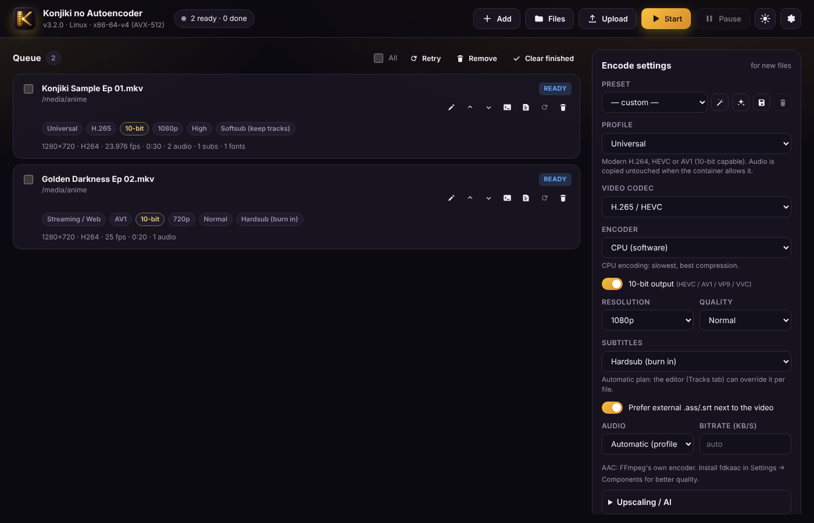
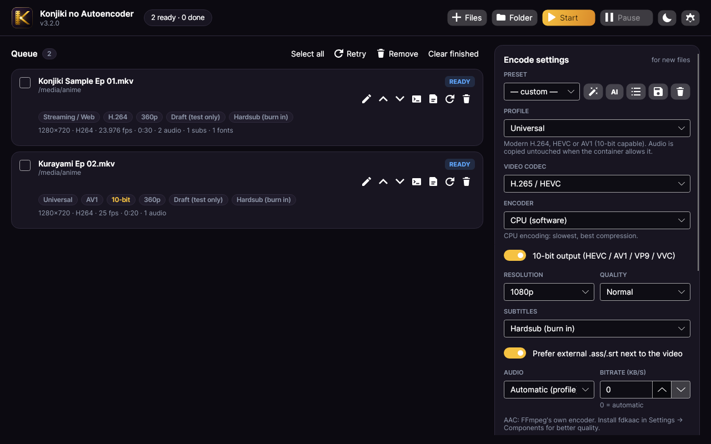
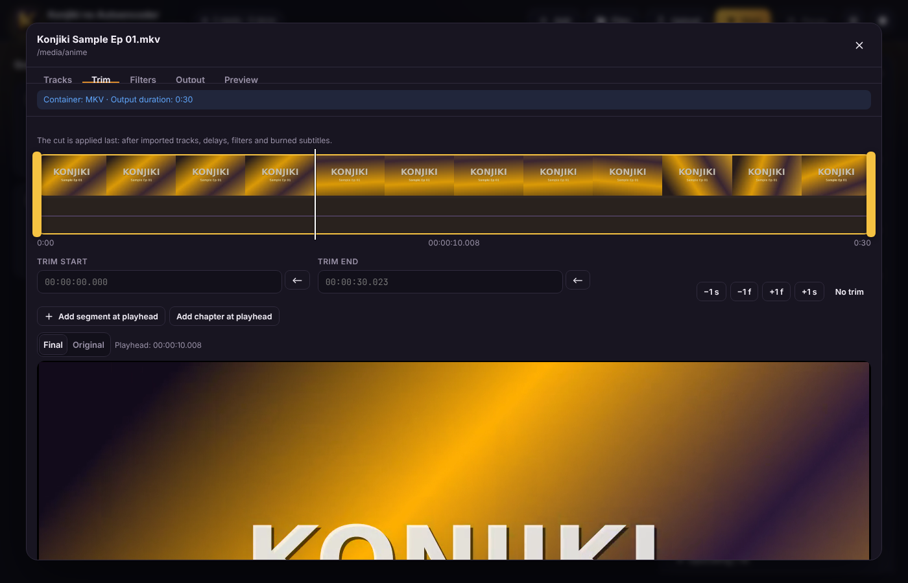
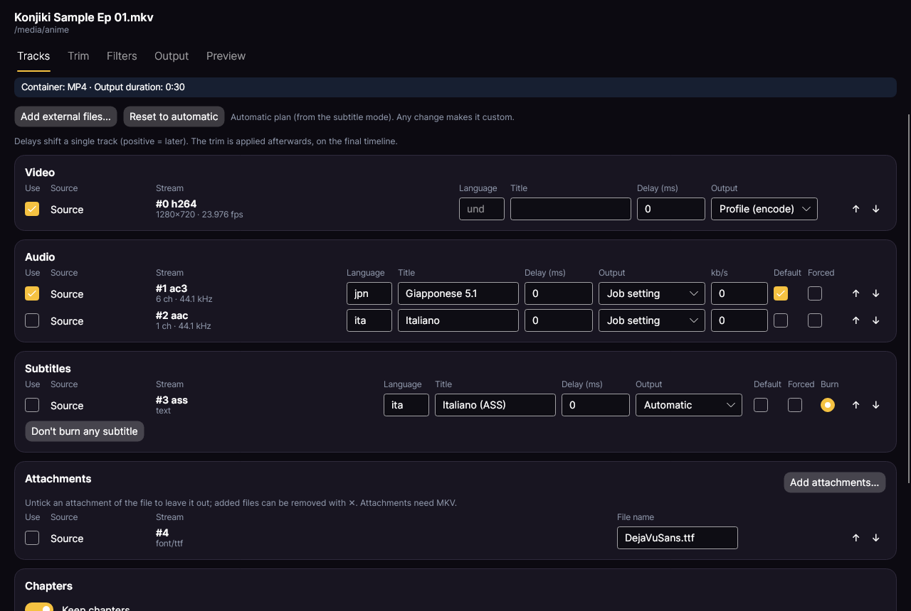
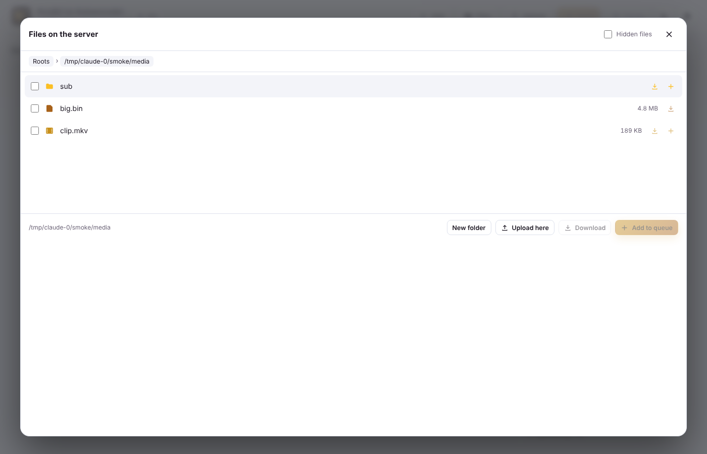
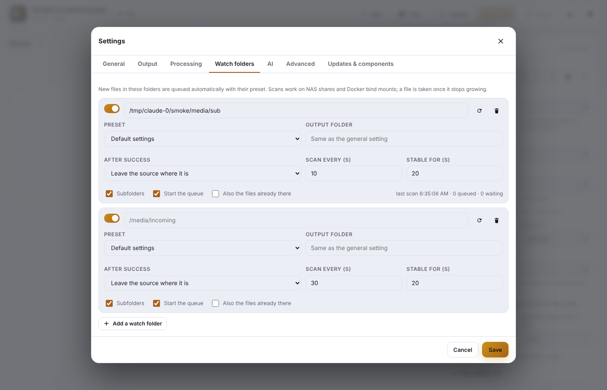
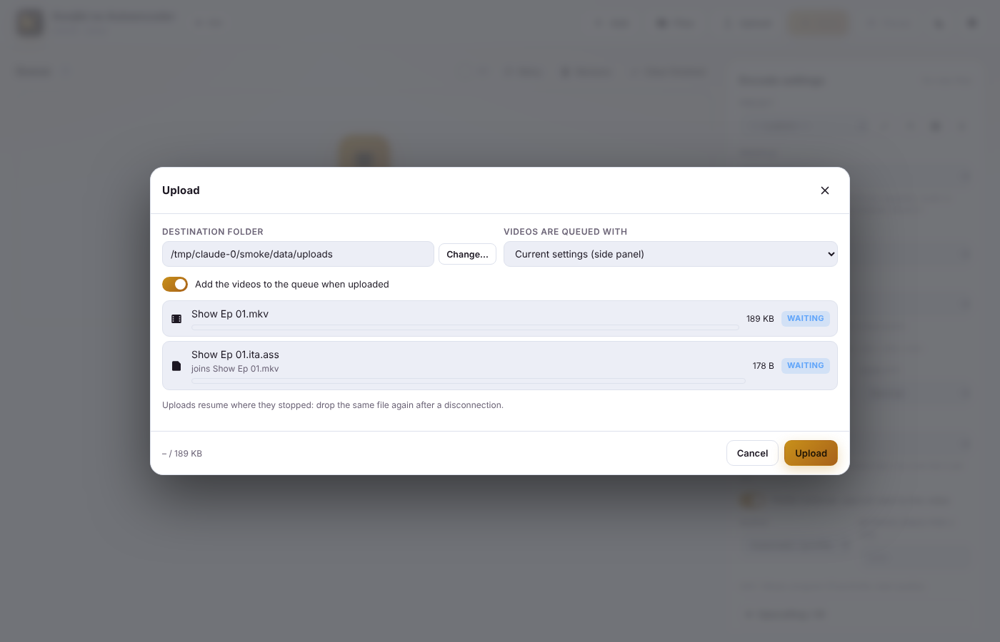
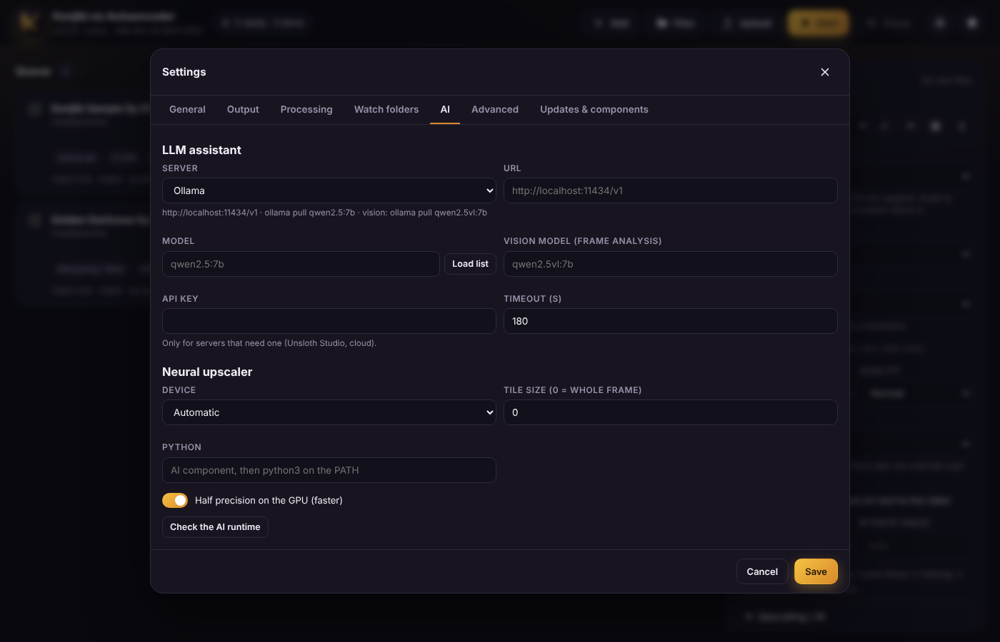
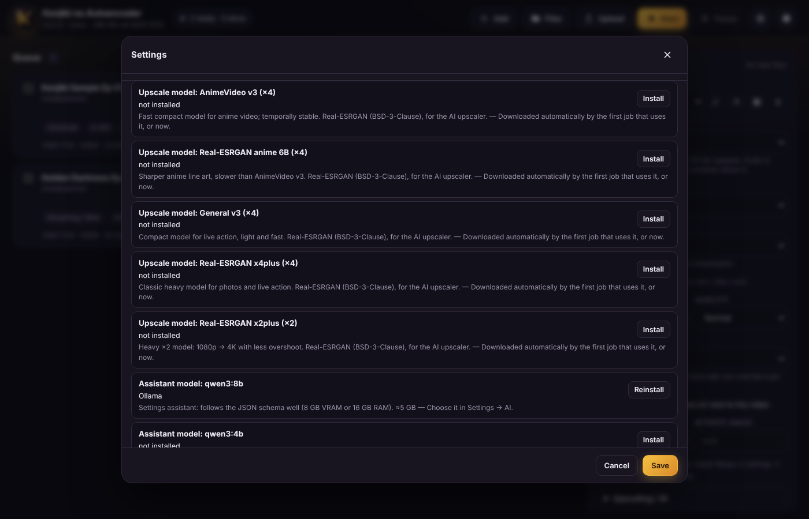
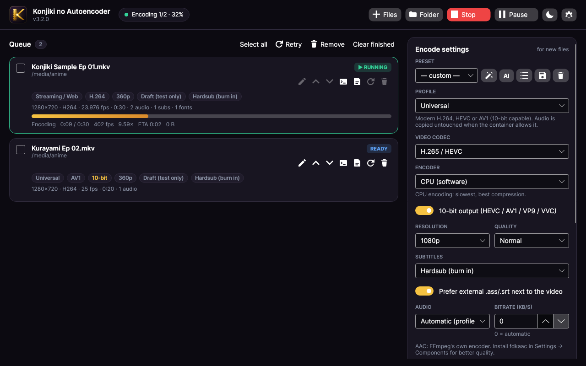

<p align="center"></p>

# KnA - Konjiki no Autoencoder 3.2

**English** · [Italiano](README.it.md)

An almost automatic encoder and hardsubber by KonjikiNoYami, for **.NET 10**.

Drop in episodes, folders, **Blu-rays (BDMV / ISO) or DVDs** and pick a profile or a preset. KnA finds the right subtitles, extracts the fonts,
burns subtitles with libass and encodes on the **CPU or the GPU** (NVENC, Quick Sync, AMF, VideoToolbox, VA-API, **Vulkan**):
H.264, HEVC, AV1, VP9, VVC, MPEG-2 and the professional **ProRes, DNxHR, CineForm, FFV1, Ut Video, FFVHuff, JPEG 2000, v210**,
with **HDR10 / HDR10+ / Dolby Vision**, resumable segmented encoding, **GPU and neural upscaling**, and a local **LLM assistant**.

### New in 3.2
- **Resumable encodes**: stop, close KnA or even crash — *Start* continues every job exactly where it was, without asking.
- **Hardware decoding** with GPU encoders (NVDEC & co.): UHD HEVC sources no longer slow NVENC down; faster parallel encoding.
- **Fast previews**: a still frame filters 5 frames instead of ~200; old requests are cancelled.
- **Advanced encoder** settings (CRF/CQ value, bitrate, speed preset, tune, GOP, B-frames, lookahead, extra options),
  **track selection rules** in presets, and a **preset manager** that applies only the parts you choose.
- **HDR → SDR** with stable brightness, a choice of tone-mapping curve and no HDR metadata left in SDR files.
- **Truly portable**: one executable, FFmpeg included, every dependency in its own subfolder.
- **NVEncC / QSVEncC / VCEEncC** (rigaya) as encoder program, GPU first: GPU decoding, KnA's filters as the encoder's GPU filters (crop, deinterlace, HDR → SDR, denoise, deband, resize, sharpen, burned subtitles, trim), scripts read directly (--vpy / --avs), speed / quality profiles, Dolby Vision / HDR10+ copy, parallel parts.
- **qaac** (Apple AAC) first, libfdk_aac / fdkaac as fallback; **Real-ESRGAN and Ollama models** downloadable from Components.
- **x86-64-v3/v4** aware (AVX-512 for x265); previews render on release instead of while zapping.

### New in 3.1
- **Tracks tab lists everything** (audio included, Demux too) and lets you **copy or convert each track** right from the list.
- **Attachments and chapters** can be added, removed and edited per file.
- **Trim with several segments**: joined into one file, or split into one queue job per segment.
- **AI runtime without installing Python**: a portable Python is downloaded when needed; PyTorch's CUDA build matches the driver.

All changes: [CHANGELOG.md](CHANGELOG.md).

### New in 3.0
- **New icon** (a golden K: the stem is a film strip, the arms meet in an autoencoder's bottleneck).
- **Professional and lossless codecs**, an **audio codec** choice (AAC, HE-AAC, Opus, FLAC, ALAC, PCM, AC-3, E-AC-3, TrueHD, DTS…).
- **The best AAC with nothing to set up**: libfdk_aac → AudioToolbox → bundled **fdkaac** program → FFmpeg's AAC.
- **Custom FFmpeg builds**: each job runs on the build that has its encoders; the downloaded FFmpeg is the **newest release branch**.
- **A clear error when the chosen GPU has no encoder** (or failed the test), instead of a silent fallback or a failure halfway.
- **Blu-ray / DVD / ISO**: one job per title (episode), track languages read from the playlist.
- **Web**: the whole file system (or chosen roots), a **file manager with downloads** (folders as ZIP), **resumable uploads**, **watch folders per preset**.
- **Docker with bind mounts only**, no volumes.
- **Smart drag & drop** on desktop and web.
- **AI**: assistant through Ollama, LM Studio, Unsloth Studio, llama.cpp, vLLM…; Anime4K / FSRCNNX GPU upscaling and Real-ESRGAN through PyTorch.

| Web edition (Docker / Proxmox / any browser) | Desktop edition (Windows / macOS / Linux) |
|---|---|
|  |  |
|  |  |
|  |  |
|  |  |
|  |  |

## Two front-ends, one engine

| | **Web edition** `src/KnA.Server` | **Desktop edition** `src/KnA.App` |
|---|---|---|
| Runs on | Docker, Proxmox LXC/VM, NAS, or locally | Windows, macOS (Apple Silicon too), Linux |
| UI | Responsive web page (phone included), live progress via SSE | Native Avalonia window, drag & drop, Ctrl+V, Send To |
| Files | Browsed on the server (media roots) | Local disks |

Both use **`KnA.Core`**, which handles probing, command building, the queue, previews, presets, updates and logs.
The UI is in **Italian** when the system (or the browser) is Italian, in **English** otherwise; it can be forced in *Settings → General*.

## Features

### Codecs

| Group | Codecs | Notes |
|---|---|---|
| Delivery | H.264, HEVC, AV1, VP9, VVC (H.266), MPEG-2, XviD | 10-bit for HEVC / AV1 / VP9 / VVC |
| Professional (*Professional / Lossless* profile) | ProRes (Proxy…4444 XQ), DNxHR (LB…444), CineForm | MOV / MXF / MKV / AVI, profile from the quality or chosen by hand, 4:2:2 / 4:4:4 chroma |
| Lossless | FFV1 (v3, slice CRC), Ut Video, FFVHuff, JPEG 2000, uncompressed v210 | source bit depth or chosen (8–16) |
| Audio | AAC, HE-AAC, Opus, MP3, Vorbis, AC-3, E-AC-3, FLAC, ALAC, WavPack, TrueHD, DTS, PCM 16/24/32f | *Automatic* = the profile's choice, copy when possible; bitrate per channel pair |

**Alternative encoders**: for each codec/backend KnA tries several encoders in order (AV1 on the CPU: SVT-AV1 → libaom → rav1e;
JPEG 2000: OpenJPEG → native) and uses the first that passes a **real test encode**.

**GPUs** (all verified with a test encode):

| Backend | Codecs |
|---|---|
| NVIDIA NVENC | H.264, HEVC, AV1 (RTX 40/50) |
| Intel Quick Sync | H.264, HEVC, AV1, VP9, MPEG-2 |
| AMD AMF | H.264, HEVC, AV1 |
| VA-API (Linux) | H.264, HEVC, AV1, VP9, MPEG-2 |
| Apple VideoToolbox | H.264, HEVC, **ProRes** |
| **Vulkan** (any GPU, FFmpeg 7.1+ / 8.0+ / 8.1+) | H.264, HEVC, AV1, **FFV1**, ProRes |

When the chosen backend has no encoder for the codec, or its encoder failed the test on this machine, the job is flagged as an
**error before it starts**, with the list of backends that do work.

**Good AAC with nothing to configure**: libfdk_aac cannot be shipped inside a GPL FFmpeg, so KnA uses, in order, `libfdk_aac`
(when one of your custom builds has it) → `aac_at` (AudioToolbox on macOS) → the **fdkaac** program (Fraunhofer FDK AAC + a Zlib frontend,
redistributable on its own: bundled with KnA's packages and the Docker image, installable from Components; run as a separate process,
ffmpeg → WAV → fdkaac) → FFmpeg's own AAC. **HE-AAC** goes the same way.

**Custom FFmpeg builds**: *Settings → Advanced* takes extra builds (e.g. one compiled with libfdk_aac, or a nightly with Vulkan encoders)
and paths for ffprobe, fdkaac, dovi_tool, hdr10plus_tool, mkvmerge, vspipe and scxvid. The detection tests every build; each job runs on the one that has
its encoder (custom builds first, the one with libfdk_aac preferred). The component manager downloads the **BtbN build of the newest release branch**
(e.g. 9.0) or, on request, master.

### Blu-ray, DVD and ISO images
- **BDMV** folders (or the folder holding them), **VIDEO_TS** folders and **.iso** files are added like any video.
- Every **episode-length title** becomes a job (`Disc - playlist 00002`), or only the main title; duplicate playlists are skipped.
- Reading: FFmpeg's `bluray:` protocol (libbluray, ISO too) and `dvdvideo` demuxer (FFmpeg 7+, ISO too). Without them KnA reads the
  folders **itself**: an MPLS/CLPI parser for Blu-rays (clips joined with the right in/out points) and an IFO parser for DVDs.
- Blu-ray track **languages** come from the playlist (the transport stream has none).

### Upscaling and AI
| Method | Runs on | For |
|---|---|---|
| Standard (Lanczos) | CPU | downscaling only, as before |
| EWA Lanczos (libplacebo) | any Vulkan GPU | high-quality enlarging |
| **Anime4K** modes A/B/C/A+A | GPU (libplacebo) | anime, near real time |
| **FSRCNNX** | GPU (libplacebo) | small neural network, live action too |
| **Neural**: Real-ESRGAN, AnimeVideo v3, any *spandrel* model (.pth/.safetensors) or .onnx | PyTorch on CUDA (RTX 50 included), ROCm, Apple MPS, CPU | best quality |

Shaders and the **AI runtime** (a private Python environment with the PyTorch build that fits your GPU) install from *Components*.
**No Python needed**: when the system has no suitable one (3.11–3.14; the Windows Store stub doesn't count) KnA downloads a **portable Python**
(python-build-standalone, checksum verified) into its data folder. PyTorch comes from download.pytorch.org with the newest **CUDA build your driver
supports** (read from `nvidia-smi`; RTX 50 / Blackwell need CUDA 12.8+), ROCm on AMD/Linux, the default build on macOS (MPS), CPU otherwise.
The component shows the installed and the newest PyTorch (PyPI) and *Update* upgrades it; an environment built on a Python too old for current
PyTorch is rebuilt. The official
Real-ESRGAN models download on first use. The `ai/kna_upscale.py` sidecar decodes the source with KnA's filters, runs the model and pipes 16-bit
RGB frames to the encoding FFmpeg: burned subtitles, audio, chapters, segmented encoding and previews work as usual.

**LLM assistant** (*Settings → AI*): Ollama, LM Studio, **Unsloth Studio**, llama.cpp, vLLM, LocalAI, Jan or any OpenAI-compatible cloud service.
- *Ask*: "small MP4 for Telegram under 2 GB, 720p, burned subtitles" → proposed settings.
- *Analyse frames*: a **vision** model (e.g. `qwen2.5vl`, `gemma3`, `llava`) looks at a few frames and proposes filters and the upscaler.

The LLM **does not encode the video** (that's not what it can do): it chooses settings. The answer is JSON restricted to KnA's options,
validated field by field and checked against the hardware detection; nothing changes until you press *Use these settings*.

### Web edition: files, uploads, downloads, watch folders
- The **whole file system** of the machine it runs on (every drive on Windows, `/` elsewhere) or only the `KNA_MEDIA_ROOTS` roots,
  plus **read-only** roots (`KNA_READONLY_ROOTS`). Without a password KnA warns in the log.
- **File manager**: browse, create folders, **download** files (resumable) or whole folders (streamed **ZIP**), add to the queue.
- **Uploads** from the browser in 16 MB chunks, **resumable** after a disconnection, straight into the destination folder;
  videos are queued with the chosen preset, subtitles/audio/fonts join their video.
- **Watch folders**: each folder has its **preset**, output folder, subfolders, auto start and an after-success action
  (keep, move to `_done`, delete). Scanning works on NAS shares and bind mounts; a file is taken once it stops growing.
- Every job's result downloads from the ⬇ button in the queue.

### Subtitle OCR

Picture subtitles of Blu-rays (PGS) and DVDs (VobSub) become text, like in Subtitle Edit: KnA decodes them and reads
them with Tesseract 5 and the language model of each track. Open the **OCR editor** of a track to check and correct
every line, turn on "Convert picture subtitles to text" for every file, or choose "Text (OCR)" for a track. Tesseract
and the Italian and English models are in every package (other languages download on first use); PaddleOCR, the
second engine, installs with one click from the OCR editor.

### Smart drag & drop
Desktop and web: videos, scripts, discs and folders are queued; **subtitles, audio and fonts** join the job they are dropped on or the video
with the same name (`Ep01.ita.ass` → `Ep01.mkv`; with hardsub the subtitle becomes the burned one); `.json` **presets** are imported;
duplicates, unsupported files and huge folders are shown before anything happens.

### Encoding
- **Profiles**: Universal (H.264/HEVC/AV1/VP9/VVC/MPEG-2), Streaming/Web, **Professional / Lossless**, Blu-ray AAC / AC-3, Workraw, XviD+MP3,
  Remux→MP4, Remux→MKV, **Images** (PNG / JPEG / TIFF / WebP / BMP), **Demux** and Aegisub keyframes.

- **Resumable encodes**: every video encode is written in 60 s pieces by a single FFmpeg; after a stop, a crash or a restart
  *Start* continues it after the last finished piece, frame-exact (Settings → Processing).
- **Hardware decoding** (NVDEC, D3D11VA, VA-API, VideoToolbox) with GPU encoders, so the CPU no longer limits a GPU encode.
- **Segmented encoding** (av1an-style): the video is split at keyframes, segments are encoded in parallel,
  and a stopped job **resumes from the last finished segment**. Ideal for slow CPU encoders (x265, SVT-AV1); with a GPU encoder
  two segments are usually the most that helps (the GPU has one to three encoder engines).
- **HDR**: HDR10 is kept (mastering display and light levels passed to the encoder) or **tone-mapped to SDR**
  in BT.709 (libplacebo when available, otherwise zscale). The **tone-mapping curve** is a choice (Spline by default, BT.2390, BT.2446a,
  Hable, Mobius) and the brightness follows the mastering metadata, stable across the film; scene-by-scene peak detection is optional.
  The SDR file carries no HDR metadata (mastering display, MaxCLL/MaxFALL, HDR10+). **Dolby Vision** (RPU via `dovi_tool`) and **HDR10+**
  (via `hdr10plus_tool`) are carried by themselves through every path: x265, NVEncC/QSVEncC/VCEEncC, scripts, trims (only the kept
  frames), crops (RPU active area), FFmpeg's GPU encoders and chunked encodes (injected into the finished HEVC); `mkvmerge` writes the
  Dolby Vision configuration record TVs need. Only a frame-count change (frame rate, IVTC) keeps static HDR, and KnA says so.
- **Containers**: MKV, MP4, MOV, WebM, AVI, TS, with a compatibility check for the chosen codecs
  (an AVI cannot hold HEVC, attachments need Matroska, and so on).

### Per-file editor
Every file in the queue has an editor (✎) with five tabs:

1. **Tracks**: **every** stream of the file is listed (video, audio, subtitles, attachments), in every profile, Demux included;
   use, remove or replace them and add **external audio, subtitles, fonts and other files**.
   MKV / MKA / MP4 files are analysed and you tick the streams to import. Each track has language, title,
   default/forced flags and its own **delay** (video, audio and subtitles). One subtitle can be burned in.
   - **Output per track**: copy or convert each stream right from the list: video *copy* (no re-encoding, filters skipped),
     audio *copy* or AAC / HE-AAC / Opus / AC-3 / E-AC-3 / FLAC / … with its own bitrate, subtitles *copy* or SRT / ASS / WebVTT / mov_text
     (checked against the container: bitmap subtitles can't become text).
   - **Attachments**: untick the file's attachments to drop them, **add** fonts, covers or any other file (✕ removes them).
   - **Chapters**: listed with time and title; add, remove, rename, move, "every 5 minutes", or go back to the file's chapters.
     Times are on the original timeline: cuts move them automatically.
   - In **Demux** the ticked tracks, attachments and chapters are the files that get extracted.
2. **Trim**: visual timeline with thumbnails and audio waveform, draggable handles, frame-accurate nudges.
   **Several segments**: add as many kept parts as you like (*Add segment at playhead*), then either **join** them into one file
   (each part is made with the same settings and the parts are joined without re-encoding; chapters follow) or
   **create N jobs in the queue**, one per segment (outputs named "… - part N").
   **The cut is always applied last**, after imported tracks, delays, filters and burned subtitles, so a subtitle
   imported with a delay stays in sync after the cut.
3. **Filters**: orientation (rotated phone videos are detected; rotation and mirroring can be corrected),
   deinterlace, crop (with black-border detection), denoise, deband, sharpen, frame rate, custom FFmpeg filters;
   audio gain, loudness normalization (EBU R128), stereo downmix, sample rate.
   **VapourSynth** and **AviSynth+** can be chosen as the frameserver, with ready-made templates; audio produced by the script is supported.
4. **Output**: every setting of the profile, container, HDR mode, segmented encoding, image or demux options (the streams are chosen in *Tracks*), destination,
   "save as preset" and the exact FFmpeg command.
5. **Preview**: the final frame (filters, burned subtitles, HDR conversion) at any position, plus a 6-second clip of the result.
   All previews (frames, thumbnails, waveform, crop detection, clips) also work with VapourSynth and AviSynth sources.

### Presets
Built-in presets, your own presets saved from any file, and a **wizard** that asks only the questions that apply
(what is it for, kind of picture, codec, encoder — only GPUs that passed the hardware test —, 8/10-bit, quality level,
CRF value, bitrate or file size, resolution, HDR, clean-up, container, audio codec/bitrate/channels, languages,
subtitles, OCR, segments) and shows what the preset will do before saving it. In the editor (pencil) a preset or a
profile is only imported: its choices become visible values in the fields, which can then be changed one by one.

### Robustness
- **Transport streams** (`.ts`, `.m2ts`…): larger probe window, regenerated timestamps, corrupt packets and unknown
  data/teletext streams are ignored, so odd broadcast metadata no longer breaks FFmpeg.
- Disk-space and write checks before starting, a watchdog for stuck FFmpeg processes, crash logs,
  log rotation, a queue that survives restarts, temporary files cleaned up.
- **Never overwrites anything**: outputs follow a name template (`{name} [{label}]` by default), and a counter is added when the name already exists.

### Updates
- *Settings → Updates & components* checks the **GitHub releases of this repository** for a new KnA version
  (the desktop app downloads and installs it; the server shows how to update the container or the service).
- **FFmpeg, ffprobe, dovi_tool and hdr10plus_tool** are installed or updated from their official release pages
  (BtbN FFmpeg builds on Windows/Linux, Homebrew on macOS).
- **AI runtime**: portable Python when needed, PyTorch (CUDA matched to the driver / ROCm / MPS / CPU), spandrel; update check against PyPI.

### Desktop integration
- **Windows "Send to"**: *Settings → Output* adds a "KnA" entry plus one entry per chosen preset (adds the files with that
  preset and starts the queue). Many files sent at once go into the same window.
- **Linux**: "Open with", Nautilus scripts and a Dolphin service menu with the same entries.
- Command line: `KnA [--preset "Name"] [--start] files-or-folders…`

## Quick start

### Download (portable)

Get the latest package from **[Releases](https://github.com/KonjikiNoYami1991/KnA/releases/latest)**:

One complete package per system — download the one for your computer, nothing else is needed:

| System | Desktop app | Server (web UI) | Run |
|---|---|---|---|
| Windows (most PCs) | `KnA-Windows-x64.zip` | `KnA-Server-Windows-x64.zip` | unzip anywhere (USB stick too), open `KnA\KnA.exe` |
| Windows on Arm (Snapdragon) | `KnA-Windows-ARM64.zip` | — | as above |
| macOS, Apple M1–M4 | `KnA-macOS-AppleSilicon.zip` | Docker | unzip, move `KnA.app` to Applications |
| macOS, Intel | `KnA-macOS-Intel.zip` | Docker | as above |
| Linux (most PCs) | `KnA-Linux-x64.tar.gz` | `KnA-Server-Linux-x64.tar.gz` | `tar xzf KnA-Linux-x64.tar.gz && ./KnA/KnA` |
| Linux on Arm (Raspberry Pi 5…) | `KnA-Linux-ARM64.tar.gz` | `KnA-Server-Linux-ARM64.tar.gz` | as above |

Every package is complete: download, extract, use. FFmpeg, fdkaac, Tesseract with the Italian and English models, the
archive engine, shaders and upscale models are inside (on macOS inside `KnA.app`, which needs macOS 14 or later; no
Homebrew). Only two optional parts weigh gigabytes and depend on your GPU: **PyTorch** for the AI upscaler and
**PaddleOCR**; KnA offers them with one click when you choose a feature that needs them. Servers are easiest with
Docker or the Linux / Proxmox installers below, which download the right package by themselves.

Portable packages need nothing installed (.NET and **FFmpeg** are included) and keep everything in the program folder,
each kind of thing in its own subfolder:

```
KnA\
  KnA.exe            one executable (+ the native libraries of the UI)
  portable.txt
  tools\ffmpeg\      FFmpeg + FFprobe (BtbN GPL build) · tools\fdkaac\ · tools\dovi_tool\ · tools\hdr10plus_tool\ · tools\mkvtoolnix\ · tools\shaders\
  tools\nvencc\ tools\qsvencc\ tools\vceencc\   rigaya's GPU encoders (Windows / Linux x64)
  tools\qaac\       qaac (Windows; Apple's files are extracted on your PC: Components → qaac → Install)
  tools\vapoursynth\ VapourSynth R82 + portable Python 3.13 + vsjetpack + the filter catalogue's plugins (every package)
  ai\                AI upscaler: script, Real-ESRGAN models (portable Python + PyTorch from Components)
  data\              settings, presets, queue, logs, temporary files
```

The server packages have the same layout (folder `KnA-server`, program `kna-server`).

Components installed or updated from the app go to the same folders. Delete `portable.txt` to use
the per-user folder instead. If the folder is read-only (e.g. Program Files) KnA falls back to the per-user folder.
The in-app updater downloads the same package and replaces only the program files (tools, models and data stay).

### Proxmox VE: one command on the host

Creates an LXC container (resources, network, GPU passthrough, bind mounts of your video folders, user mapping)
and installs KnA inside it as a native service, with a wizard:

```bash
bash -c "$(curl -fsSL https://raw.githubusercontent.com/KonjikiNoYami1991/KnA/master/deploy/proxmox/kna-lxc.sh)"
```

### Linux server, LXC or VM (native, no Docker)

On Debian 12+ / Ubuntu 22.04+ (amd64, arm64), as root. The wizard asks for the video folders, the password, the GPU runtime and the components:

```bash
curl -fsSL https://raw.githubusercontent.com/KonjikiNoYami1991/KnA/master/deploy/install-linux.sh | bash
```

Update with `kna-update`. Both scripts, their unattended mode and the permissions of bind mounts are explained in
**[docs/PROXMOX.md](docs/PROXMOX.md)** ([italiano](docs/PROXMOX.it.md)).

### Windows server (service)

In an administrator PowerShell: downloads the server package, registers the **KnA** service (starts with Windows,
restarts after a crash), opens the port in the firewall. Run it again to update or change settings.

```powershell
irm https://raw.githubusercontent.com/KonjikiNoYami1991/KnA/master/deploy/install-windows-server.ps1 | iex
```

With options: save the script, then `.\install-windows-server.ps1 -MediaRoots "D:\Video;\\nas\film" -Password "secret"`.
NAS shares: use UNC paths and `-ServiceUser "PC\name"` (a service cannot see mapped drive letters).

### Docker (headless server)

A **ready-made image** for amd64 and arm64 is published with every release: `ghcr.io/konjikinoyami1991/kna`.
Bind mounts only (no Docker volumes): config, videos and uploads are real folders on the host. Inside: FFmpeg (BtbN),
**fdkaac**, NVEncC/QSVEncC, VA-API/QSV/Vulkan drivers and Python for the AI runtime.

```bash
curl -fsSLO https://raw.githubusercontent.com/KonjikiNoYami1991/KnA/master/docker-compose.yml
# edit it: your video folder, PUID/PGID (id -u / id -g), a password
docker compose up -d
```

`PUID`/`PGID` make KnA write files as your user; the GPU device groups are joined by themselves.
Update: `docker compose pull && docker compose up -d`. Step by step for **Synology, QNAP, UGREEN, Unraid and Portainer**:
**[docs/DOCKER.md](docs/DOCKER.md)** ([italiano](docs/DOCKER.it.md)).

To build the image yourself: uncomment the `build:` section of docker-compose.yml (arguments `FFMPEG=btbn-release`
· `btbn-master` · `distro`; `FDKAAC=1`; `RIGAYA=1`) and run `docker compose up -d --build`.
For an LLM on the host (Ollama, LM Studio…) use `http://host.docker.internal:<port>/v1`.

Then open `http://<host>:8585`. The environment variables are listed in **[docs/PROXMOX.md](docs/PROXMOX.md#environment-variables)**.

### Desktop from source

```bash
dotnet run --project src/KnA.App -c Release
```

On Windows and Linux, *Settings → Updates & components* installs FFmpeg (BtbN static build of the newest release branch, GPL: libass,
x264, x265, SVT-AV1, NVENC, QSV, AMF, VA-API, Vulkan, libplacebo), fdkaac, the Anime4K/FSRCNNX shaders and the AI runtime.
On macOS, run `brew install ffmpeg` (AAC uses AudioToolbox).

### Web edition on your own PC

```bash
dotnet run --project src/KnA.Server -c Release -- --open
```

### VapourSynth and AviSynth

- **VapourSynth** is included in every package (tools/vapoursynth: portable Python, VapourSynth, vsjetpack and the
  filter catalogue's plugins); from source code, install it from Settings → Components, or point `KNA_VSPIPE` to
  another installation. It reads the video of CPU encodes (Settings → Processing) and runs the catalogue's filters;
  `.vpy` files can be added to the queue directly.
- **AviSynth+**: install AviSynth+ and use an FFmpeg built with `--enable-avisynth`; `.avs` scripts are read by FFmpeg.
  KnA shows a clear message when the FFmpeg in use cannot read them.

Frameserver decoding happens in the script, so it does not use hardware decoding; the encoder can still be a GPU one.

## Accounts (web server)

Every person signs in with their own account. At the first start KnA asks to create the **administrator**; the
administrator then creates, edits, disables and removes the other accounts in **Settings → Accounts**.

- **Roles**: *administrators* manage the server (settings, components, watch folders, accounts); *users* encode.
  For each user: the **allowed folders** (inside the server's media roots; empty = all of them) and **advanced mode**
  (hand-written VapourSynth/AviSynth scripts, extra encoder and tool arguments, custom FFmpeg filters: they run on the
  server, so they are off for new users; scripts and arguments already in the presets or the defaults keep working).
- **Security**: passwords are stored as salted PBKDF2-SHA256 hashes (600,000 iterations); the browser keeps an
  HttpOnly, SameSite=Strict session cookie (Secure over HTTPS; "stay signed in" = 30 days, otherwise 12 idle hours);
  after 5 wrong passwords each further attempt waits twice as long (per address and per user name, up to 15 minutes).
  Changing a password signs the account out on its other devices.
- **Own queue, presets and settings**: each user sees and manages only their own files (the server encodes everybody's
  in queue order; *Stop* stops only theirs), their own presets next to the built-in and the **shared** ones (the
  administrators'), and their own quick-form defaults and theme. Administrators see every job with its owner's name
  and manage each user's presets, settings and queue in Settings → Accounts (a user's preset can be shared with
  everybody). In the editor, users without advanced mode see the fields of hand-written code and arguments locked.
- **Scripts and curl** keep using HTTP Basic: `curl -u name:password http://server:8585/api/...`.
- **From `KNA_PASSWORD`** (older installs, Docker, Linux and Windows services): at the first start of this version the
  password becomes the administrator **`admin`** (`KNA_ADMIN_USER` to choose another name); HTTP Basic with any user
  name and that password still works until the password is changed. After that the variable is not used any more.
- **Lost password**: `sudo kna-reset-password` (Linux installer, Proxmox container), `docker exec -it kna dotnet /app/kna-server.dll
  --reset-password admin` (Docker) or `kna-server --reset-password admin` with the service's `KNA_DATA_DIR` asks for a new
  one and re-enables the account, also while KnA is running.
- `KNA_AUTH=off` switches accounts off (everybody is an administrator): only on a trusted network.
- **HTTPS / reverse proxy** (nginx, Caddy, Traefik, Nginx Proxy Manager, on a domain or under a path like `/kna`):
  [docs/REVERSE-PROXY.md](docs/REVERSE-PROXY.md); with **single sign-on** (Authelia, Authentik, oauth2-proxy) KnA takes
  the user the proxy signed in, creates the account at the first visit and follows the admin group.

## Desktop app on a KnA server

The desktop app can use a KnA server as its engine: a powerful PC or a homelab server runs kna-server, a laptop runs
the desktop app. **Settings → KnA server**: "Search the local network" finds the servers by themselves (or type the
address), then the account of the server; the password stays in the system's keychain (Windows Credential Manager,
macOS Keychain, Secret Service through `secret-tool` on Linux). The top bar shows where the files are encoded; back to
this computer is one click.

- Everything works as on this computer, and runs there: the queue (start, stop, pause, order, logs), the editor
  (tracks, trim, filters, parameter pages, previews and waveforms, size estimate), the OCR editor, the AI assistant, the
  server's presets (shared and your own) and the wizard; the hardware panel shows the server's. "Server files" queues
  the server's own files where they are.
- Files of the laptop are **uploaded by themselves** (resumable; subtitles, audio and fonts added in the editor or
  dropped on a job too) and the **results come back by themselves** into the
  output folder (or next to the source), then the server deletes what it kept for them. Once a file is uploaded the
  laptop may be switched off: the result comes home at the next connection.
- If the server can't be reached, KnA says why and encodes on this computer meanwhile.
- HTTPS through a reverse proxy works; a self-signed certificate is shown with its fingerprint and pinned once trusted.
  Plain HTTP outside the local network is flagged.

Discovery answers on UDP port 8585 (`KNA_DISCOVERY_PORT`, `KNA_DISCOVERY=off`; `KNA_PUBLIC_URL` = the address to
announce). Broadcasts don't cross subnets, VPNs or Docker bridge networks: type the address there.

## Environment variables

| Variable | Use |
|---|---|
| `KNA_DATA_DIR` | data folder (settings, presets, queue, logs, AI models) |
| `KNA_PORTABLE` | `1` = portable mode without `portable.txt` (data in `data` next to the program) |
| `KNA_MEDIA_ROOTS` | read/write roots, `;` separated (default: the whole file system; `/media` in Docker) |
| `KNA_READONLY_ROOTS` | read-only roots |
| `KNA_UPLOAD_DIR` · `KNA_MAX_UPLOAD_GB` | upload destination and limit |
| `KNA_PASSWORD` · `KNA_ADMIN_USER` | first start only: creates the administrator (default name `admin`) with this password |
| `KNA_AUTH` | `off` = no accounts, everybody is an administrator (trusted networks only) |
| `KNA_TRUSTED_PROXIES` | reverse proxies whose `X-Forwarded-*` headers are believed: addresses, networks (`172.18.0.0/16`) or `private`; this machine always ([guide](docs/REVERSE-PROXY.md)) |
| `KNA_BASE_PATH` | path KnA is published under behind a reverse proxy, e.g. `/kna` |
| `KNA_DISCOVERY` · `KNA_DISCOVERY_PORT` · `KNA_PUBLIC_URL` | desktop apps find the server on the local network (UDP 8585; `off` to switch it off; the address to announce) |
| `KNA_SSO` · `KNA_SSO_ADMIN_GROUP` · `KNA_SSO_USER_GROUP` · `KNA_SSO_SECRET` · … | single sign-on from the proxy: `authelia`, `authentik` or a header name ([guide](docs/REVERSE-PROXY.md#single-sign-on-authelia-authentik-oauth2-proxy)) |
| `KNA_ALLOW_ADVANCED` | lets administrators edit FFmpeg paths, custom builds, extra arguments, Python from the browser |
| `KNA_FFMPEG` · `KNA_FDKAAC` · `KNA_VSPIPE` · `KNA_AI_SCRIPT` | program paths |
| `KNA_VULKAN_DEVICE` | Vulkan GPU for libplacebo (index or name part; `llvmpipe` = CPU) |
| `KNA_URLS` · `KNA_LANG` · `KNA_LOCK_COMPONENTS` · `KNA_ALLOW_POWER_ACTIONS` | as before |

## Building and testing

You need the [.NET 10 SDK](https://dotnet.microsoft.com/download) and, for the integration tests, FFmpeg on your PATH.

```bash
dotnet build KnA.slnx
dotnet test KnA.slnx
```

The tests build sample media with FFmpeg (anamorphic video, 5.1 audio, ASS/SRT subtitles, fonts, an HDR10 clip, a transport stream,
a **Blu-ray** with MPLS playlists, a **DVD** with IFOs and split VOBs, an **ISO**) and run real jobs: hardsub, softsub, remux, keyframes, external tracks,
trim, demux, images, HDR10, segmented encoding, every **professional codec**, the **audio codecs**, the **fdkaac** pipeline, watch folders,
drag & drop, the LLM assistant (fake server), plus headless renders of the desktop windows.
Optional: `KNA_TEST_VULKAN=1` (+ `KNA_VULKAN_DEVICE=llvmpipe` without a GPU) runs Anime4K, `KNA_TEST_PYTHON=<python with torch>` runs Real-ESRGAN.

Self-contained builds:

```bash
dotnet publish src/KnA.App -c Release -r win-x64 --self-contained -p:PublishSingleFile=true
dotnet publish src/KnA.App -c Release -r osx-arm64 --self-contained
dotnet publish src/KnA.Server -c Release -r linux-x64 --self-contained
```

Pushing a `v*` tag runs `.github/workflows/release.yml`, which builds every platform and prepares a **draft** release
with one complete package per system (the table above, also what the in-app updater downloads) and a `KnA.app` with
its icon for macOS. fdkaac is inside every package; for the component manager it is also published in the rolling
`components` pre-release, so version releases list only the KnA packages.

## Project layout

```
src/KnA.Core     engine (no UI): probe, track plan, filters, HDR, command builder, chunked encoder, queue, previews, presets, updates,
                 discs (Media/Discs), watch folders and drag & drop (Queue), AI (Ai: LLM, upscalers)
ai/              Python sidecar of the neural upscaler
branding/        icon (SVG source, render scripts, .ico/.icns)
build/           build-fdkaac.sh
src/KnA.Server   ASP.NET Core API + web UI (wwwroot), Docker entry point
src/KnA.App      Avalonia desktop app
tests/           xUnit unit/integration tests + headless UI test
deploy/          native Linux/LXC installer (systemd) and Proxmox VE container script
docs/            Proxmox guide, screenshots
```

## License

[GPLv3](LICENSE)
