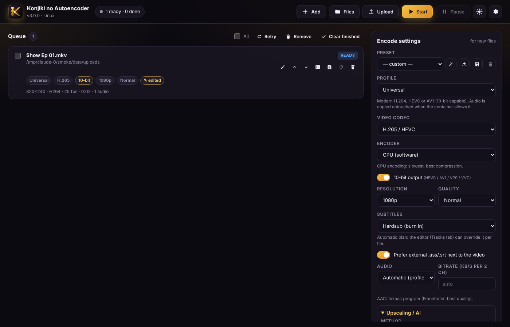
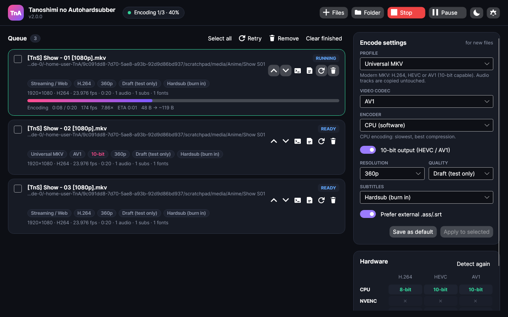
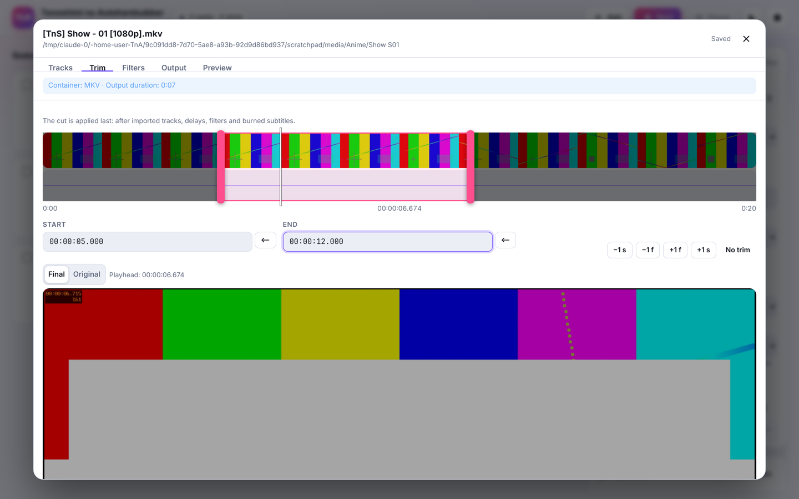
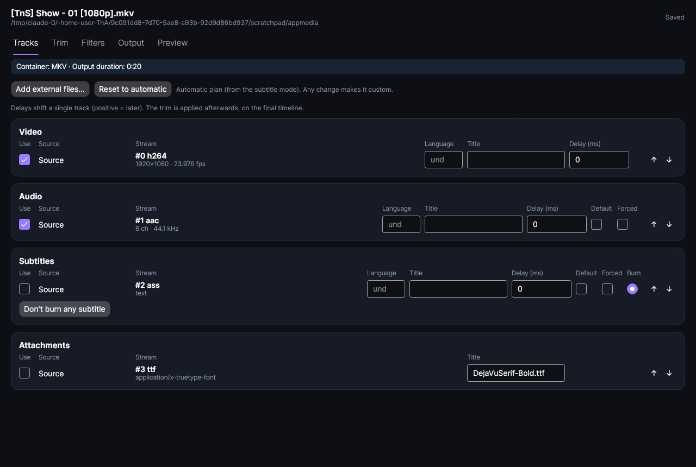
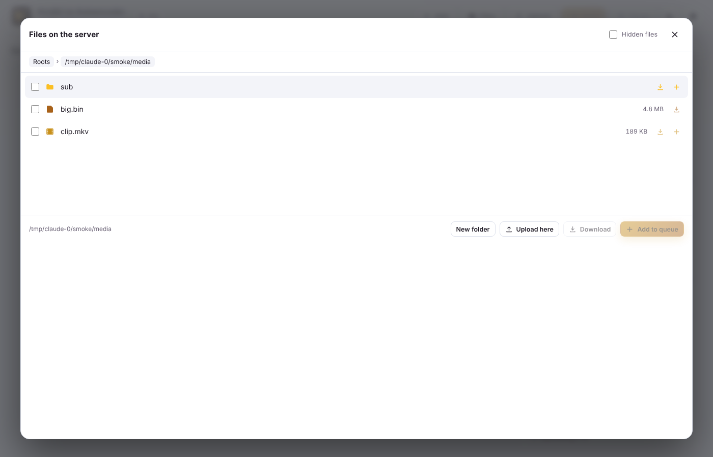
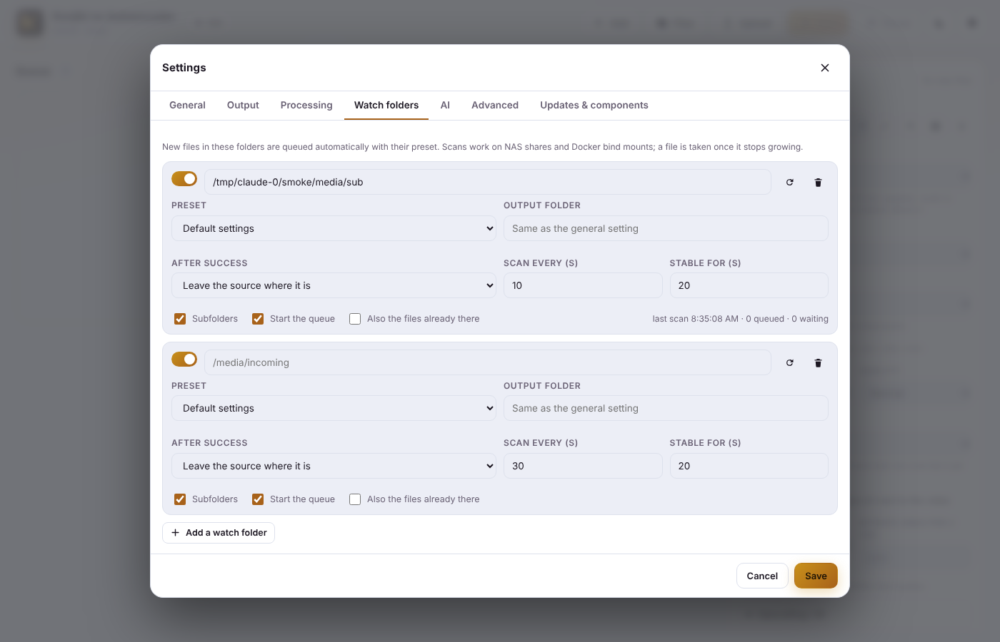
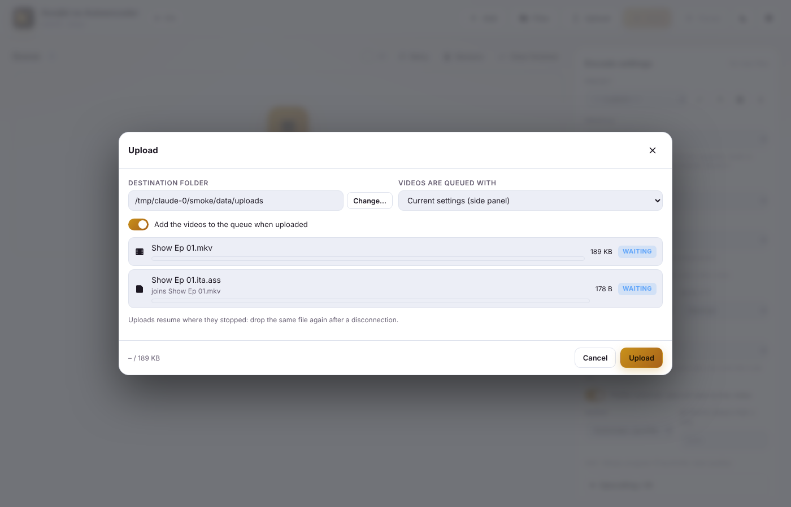
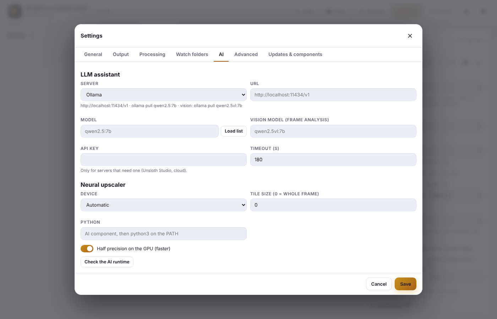

<p align="center"></p>

# KnA - Konjiki no Autoencoder 3.0

**English** · [Italiano](README.it.md)

An almost automatic encoder and hardsubber by KonjikiNoYami, for **.NET 10**.

Drop in episodes, folders, **Blu-rays (BDMV / ISO) or DVDs** and pick a profile or a preset. KnA finds the right subtitles, extracts the fonts,
burns subtitles with libass and encodes on the **CPU or the GPU** (NVENC, Quick Sync, AMF, VideoToolbox, VA-API, **Vulkan**):
H.264, HEVC, AV1, VP9, VVC, MPEG-2 and the professional **ProRes, DNxHR, CineForm, FFV1, Ut Video, FFVHuff, JPEG 2000, v210**,
with **HDR10 / HDR10+ / Dolby Vision**, resumable segmented encoding, **GPU and neural upscaling**, and a local **LLM assistant**.

### New in 3.0
- **New icon** (a golden K: the stem is a film strip, the arms meet in an autoencoder's bottleneck).
- **Professional and lossless codecs**, an **audio codec** choice (AAC, HE-AAC, Opus, FLAC, ALAC, PCM, AC-3, E-AC-3, TrueHD, DTS…).
- **The best AAC with nothing to set up**: libfdk_aac → AudioToolbox → bundled **fdkaac** program → FFmpeg's AAC.
- **Custom FFmpeg builds**: each job runs on the build that has its encoders; the downloaded FFmpeg is the **newest release branch**.
- **A clear error when the chosen GPU has no encoder** (or failed the test), instead of a silent fallback or a failure halfway.
- **Blu-ray / DVD / ISO**: one job per title (episode), track languages read from the playlist.
- **Web**: the whole file system (or chosen roots), a **file manager with downloads** (folders as ZIP), **resumable uploads**, **watch folders per preset**.
- **Docker with bind mounts only**, no volumes.
- **Smart drag & drop** on desktop and web.
- **AI**: assistant through Ollama, LM Studio, Unsloth Studio, llama.cpp, vLLM…; Anime4K / FSRCNNX GPU upscaling and Real-ESRGAN through PyTorch.

| Web edition (Docker / Proxmox / any browser) | Desktop edition (Windows / macOS / Linux) |
|---|---|
|  |  |
|  |  |
|  |  |
|  |  |

## Two front-ends, one engine

| | **Web edition** `src/KnA.Server` | **Desktop edition** `src/KnA.App` |
|---|---|---|
| Runs on | Docker, Proxmox LXC/VM, NAS, or locally | Windows, macOS (Apple Silicon too), Linux |
| UI | Responsive web page (phone included), live progress via SSE | Native Avalonia window, drag & drop, Ctrl+V, Send To |
| Files | Browsed on the server (media roots) | Local disks |

Both use **`KnA.Core`**, which handles probing, command building, the queue, previews, presets, updates and logs.
The UI is in **Italian** when the system (or the browser) is Italian, in **English** otherwise; it can be forced in *Settings → General*.

## Features

### Codecs

| Group | Codecs | Notes |
|---|---|---|
| Delivery | H.264, HEVC, AV1, VP9, VVC (H.266), MPEG-2, XviD | 10-bit for HEVC / AV1 / VP9 / VVC |
| Professional (*Professional / Lossless* profile) | ProRes (Proxy…4444 XQ), DNxHR (LB…444), CineForm | MOV / MXF / MKV / AVI, profile from the quality or chosen by hand, 4:2:2 / 4:4:4 chroma |
| Lossless | FFV1 (v3, slice CRC), Ut Video, FFVHuff, JPEG 2000, uncompressed v210 | source bit depth or chosen (8–16) |
| Audio | AAC, HE-AAC, Opus, MP3, Vorbis, AC-3, E-AC-3, FLAC, ALAC, WavPack, TrueHD, DTS, PCM 16/24/32f | *Automatic* = the profile's choice, copy when possible; bitrate per channel pair |

**Alternative encoders**: for each codec/backend KnA tries several encoders in order (AV1 on the CPU: SVT-AV1 → libaom → rav1e;
JPEG 2000: OpenJPEG → native) and uses the first that passes a **real test encode**.

**GPUs** (all verified with a test encode):

| Backend | Codecs |
|---|---|
| NVIDIA NVENC | H.264, HEVC, AV1 (RTX 40/50) |
| Intel Quick Sync | H.264, HEVC, AV1, VP9, MPEG-2 |
| AMD AMF | H.264, HEVC, AV1 |
| VA-API (Linux) | H.264, HEVC, AV1, VP9, MPEG-2 |
| Apple VideoToolbox | H.264, HEVC, **ProRes** |
| **Vulkan** (any GPU, FFmpeg 7.1+ / 8.0+ / 8.1+) | H.264, HEVC, AV1, **FFV1**, ProRes |

When the chosen backend has no encoder for the codec, or its encoder failed the test on this machine, the job is flagged as an
**error before it starts**, with the list of backends that do work.

**Good AAC with nothing to configure**: libfdk_aac cannot be shipped inside a GPL FFmpeg, so KnA uses, in order, `libfdk_aac`
(when one of your custom builds has it) → `aac_at` (AudioToolbox on macOS) → the **fdkaac** program (Fraunhofer FDK AAC + a Zlib frontend,
redistributable on its own: bundled with KnA's packages and the Docker image, installable from Components; run as a separate process,
ffmpeg → WAV → fdkaac) → FFmpeg's own AAC. **HE-AAC** goes the same way.

**Custom FFmpeg builds**: *Settings → Advanced* takes extra builds (e.g. one compiled with libfdk_aac, or a nightly with Vulkan encoders)
and paths for ffprobe, fdkaac, dovi_tool, hdr10plus_tool, vspipe and scxvid. The detection tests every build; each job runs on the one that has
its encoder (custom builds first, the one with libfdk_aac preferred). The component manager downloads the **BtbN build of the newest release branch**
(e.g. 9.0) or, on request, master.

### Blu-ray, DVD and ISO images
- **BDMV** folders (or the folder holding them), **VIDEO_TS** folders and **.iso** files are added like any video.
- Every **episode-length title** becomes a job (`Disc - playlist 00002`), or only the main title; duplicate playlists are skipped.
- Reading: FFmpeg's `bluray:` protocol (libbluray, ISO too) and `dvdvideo` demuxer (FFmpeg 7+, ISO too). Without them KnA reads the
  folders **itself**: an MPLS/CLPI parser for Blu-rays (clips joined with the right in/out points) and an IFO parser for DVDs.
- Blu-ray track **languages** come from the playlist (the transport stream has none).

### Upscaling and AI
| Method | Runs on | For |
|---|---|---|
| Standard (Lanczos) | CPU | downscaling only, as before |
| EWA Lanczos (libplacebo) | any Vulkan GPU | high-quality enlarging |
| **Anime4K** modes A/B/C/A+A | GPU (libplacebo) | anime, near real time |
| **FSRCNNX** | GPU (libplacebo) | small neural network, live action too |
| **Neural**: Real-ESRGAN, AnimeVideo v3, any *spandrel* model (.pth/.safetensors) or .onnx | PyTorch on CUDA (RTX 50 included), ROCm, Apple MPS, CPU | best quality |

Shaders and the **AI runtime** (a private Python environment with the PyTorch build that fits your GPU) install from *Components*; the official
Real-ESRGAN models download on first use. The `ai/kna_upscale.py` sidecar decodes the source with KnA's filters, runs the model and pipes 16-bit
RGB frames to the encoding FFmpeg: burned subtitles, audio, chapters, segmented encoding and previews work as usual.

**LLM assistant** (*Settings → AI*): Ollama, LM Studio, **Unsloth Studio**, llama.cpp, vLLM, LocalAI, Jan or any OpenAI-compatible cloud service.
- *Ask*: "small MP4 for Telegram under 2 GB, 720p, burned subtitles" → proposed settings.
- *Analyse frames*: a **vision** model (e.g. `qwen2.5vl`, `gemma3`, `llava`) looks at a few frames and proposes filters and the upscaler.

The LLM **does not encode the video** (that's not what it can do): it chooses settings. The answer is JSON restricted to KnA's options,
validated field by field and checked against the hardware detection; nothing changes until you press *Use these settings*.

### Web edition: files, uploads, downloads, watch folders
- The **whole file system** of the machine it runs on (every drive on Windows, `/` elsewhere) or only the `KNA_MEDIA_ROOTS` roots,
  plus **read-only** roots (`KNA_READONLY_ROOTS`). Without a password KnA warns in the log.
- **File manager**: browse, create folders, **download** files (resumable) or whole folders (streamed **ZIP**), add to the queue.
- **Uploads** from the browser in 16 MB chunks, **resumable** after a disconnection, straight into the destination folder;
  videos are queued with the chosen preset, subtitles/audio/fonts join their video.
- **Watch folders**: each folder has its **preset**, output folder, subfolders, auto start and an after-success action
  (keep, move to `_done`, delete). Scanning works on NAS shares and bind mounts; a file is taken once it stops growing.
- Every job's result downloads from the ⬇ button in the queue.

### Smart drag & drop
Desktop and web: videos, scripts, discs and folders are queued; **subtitles, audio and fonts** join the job they are dropped on or the video
with the same name (`Ep01.ita.ass` → `Ep01.mkv`; with hardsub the subtitle becomes the burned one); `.json` **presets** are imported;
duplicates, unsupported files and huge folders are shown before anything happens.

### Encoding
- **Profiles**: Universal (H.264/HEVC/AV1/VP9/VVC/MPEG-2), Streaming/Web, **Professional / Lossless**, Blu-ray AAC / AC-3, Workraw, XviD+MP3,
  Remux→MP4, Remux→MKV, **Images** (PNG / JPEG / TIFF / WebP / BMP), **Demux** and Aegisub keyframes.

- **Segmented encoding** (av1an-style): the video is split at keyframes, segments are encoded in parallel,
  and a stopped job **resumes from the last finished segment**. Ideal for slow CPU encoders (x265, SVT-AV1).
- **HDR**: HDR10 is kept (mastering display and light levels passed to the encoder) or **tone-mapped to SDR**
  (libplacebo when available, otherwise zscale + Hable). **Dolby Vision** (RPU via `dovi_tool`) and **HDR10+**
  (via `hdr10plus_tool`) are carried over when re-encoding HEVC with x265; KnA explains when that is not possible (trim, crop, frame-rate change, GPU encoders).
- **Containers**: MKV, MP4, MOV, WebM, AVI, TS, with a compatibility check for the chosen codecs
  (an AVI cannot hold HEVC, attachments need Matroska, and so on).

### Per-file editor
Every file in the queue has an editor (✎) with five tabs:

1. **Tracks**: use, remove or replace the source streams; add **external audio, subtitles, fonts and other files**.
   MKV / MKA / MP4 files are analysed and you tick the streams to import. Each track has language, title,
   default/forced flags and its own **delay** (video, audio and subtitles). One subtitle can be burned in.
2. **Trim**: visual timeline with thumbnails and audio waveform, draggable handles, frame-accurate nudges.
   **The cut is always applied last**, after imported tracks, delays, filters and burned subtitles, so a subtitle
   imported with a delay stays in sync after the cut.
3. **Filters**: orientation (rotated phone videos are detected; rotation and mirroring can be corrected),
   deinterlace, crop (with black-border detection), denoise, deband, sharpen, frame rate, custom FFmpeg filters;
   audio gain, loudness normalization (EBU R128), stereo downmix, sample rate.
   **VapourSynth** and **AviSynth+** can be chosen as the frameserver, with ready-made templates; audio produced by the script is supported.
4. **Output**: every setting of the profile, container, HDR mode, segmented encoding, image or demux options, destination,
   "save as preset" and the exact FFmpeg command.
5. **Preview**: the final frame (filters, burned subtitles, HDR conversion) at any position, plus a 6-second clip of the result.
   All previews (frames, thumbnails, waveform, crop detection, clips) also work with VapourSynth and AviSynth sources.

### Presets
Built-in presets, your own presets saved from any file, and a **wizard** that asks a few plain questions
(what is it for, compatibility or size, speed or compression, subtitles, audio) and picks a working GPU when you ask for speed.

### Robustness
- **Transport streams** (`.ts`, `.m2ts`…): larger probe window, regenerated timestamps, corrupt packets and unknown
  data/teletext streams are ignored, so odd broadcast metadata no longer breaks FFmpeg.
- Disk-space and write checks before starting, a watchdog for stuck FFmpeg processes, crash logs,
  log rotation, a queue that survives restarts, temporary files cleaned up.
- **Never overwrites anything**: outputs follow a name template (`{name} [{label}]` by default), and a counter is added when the name already exists.

### Updates
- *Settings → Updates & components* checks the **GitHub releases of this repository** for a new KnA version
  (the desktop app downloads and installs it; the server shows how to update the container or the service).
- **FFmpeg, ffprobe, dovi_tool and hdr10plus_tool** are installed or updated from their official release pages
  (BtbN FFmpeg builds on Windows/Linux, Homebrew on macOS).

### Desktop integration
- **Windows "Send to"**: *Settings → Output* adds a "KnA" entry plus one entry per chosen preset (adds the files with that
  preset and starts the queue). Many files sent at once go into the same window.
- **Linux**: "Open with", Nautilus scripts and a Dolphin service menu with the same entries.
- Command line: `KnA [--preset "Name"] [--start] files-or-folders…`

## Quick start

### Docker (headless server, e.g. Proxmox + iGPU)

The image uses **bind mounts only** (no Docker volumes): config, videos and uploads are real folders on the host.
It ships the newest release-branch static FFmpeg (BtbN), **fdkaac**, VA-API/QSV/Vulkan drivers and Python for the AI runtime.

```bash
git clone https://github.com/KonjikiNoYami1991/KnA.git && cd KnA
# edit docker-compose.yml: media folder (bind mount), password recommended
mkdir -p ./config /mnt/anime/uploads
RENDER_GID=$(getent group render | cut -d: -f3) docker compose up -d --build
```

Build arguments: `FFMPEG=btbn-release` (default) · `btbn-master` · `distro`; `FDKAAC=1`.
For an LLM on the host (Ollama, LM Studio…) use `http://host.docker.internal:<port>/v1`.

Then open `http://<host>:8585`. See **[docs/PROXMOX.md](docs/PROXMOX.md)** ([italiano](docs/PROXMOX.it.md)) for LXC GPU passthrough,
the native installer without Docker (`deploy/install-linux.sh`) and all environment variables.

### Desktop

```bash
dotnet run --project src/KnA.App -c Release
```

On Windows and Linux, *Settings → Updates & components* installs FFmpeg (BtbN static build of the newest release branch, GPL: libass,
x264, x265, SVT-AV1, NVENC, QSV, AMF, VA-API, Vulkan, libplacebo), fdkaac, the Anime4K/FSRCNNX shaders and the AI runtime.
On macOS, run `brew install ffmpeg` (AAC uses AudioToolbox).

### Web edition on your own PC

```bash
dotnet run --project src/KnA.Server -c Release -- --open
```

### VapourSynth and AviSynth (optional)

- **VapourSynth**: install it so that `vspipe` is on the PATH (or set `KNA_VSPIPE`), plus the source plugins your
  scripts use (L-SMASH Works, BestSource or FFMS2). `.vpy` files can be added to the queue directly.
- **AviSynth+**: install AviSynth+ and use an FFmpeg built with `--enable-avisynth`; `.avs` scripts are read by FFmpeg.
  KnA shows a clear message when the FFmpeg in use cannot read them.

Frameserver decoding happens in the script, so it does not use hardware decoding; the encoder can still be a GPU one.

## Environment variables

| Variable | Use |
|---|---|
| `KNA_DATA_DIR` | data folder (settings, presets, queue, logs, AI models) |
| `KNA_MEDIA_ROOTS` | read/write roots, `;` separated (default: the whole file system; `/media` in Docker) |
| `KNA_READONLY_ROOTS` | read-only roots |
| `KNA_UPLOAD_DIR` · `KNA_MAX_UPLOAD_GB` | upload destination and limit |
| `KNA_PASSWORD` | HTTP Basic password of the web UI |
| `KNA_ALLOW_ADVANCED` | lets the browser edit FFmpeg paths, custom builds, extra arguments, Python |
| `KNA_FFMPEG` · `KNA_FDKAAC` · `KNA_VSPIPE` · `KNA_AI_SCRIPT` | program paths |
| `KNA_VULKAN_DEVICE` | Vulkan GPU for libplacebo (index or name part; `llvmpipe` = CPU) |
| `KNA_URLS` · `KNA_LANG` · `KNA_LOCK_COMPONENTS` · `KNA_ALLOW_POWER_ACTIONS` | as before |

## Building and testing

You need the [.NET 10 SDK](https://dotnet.microsoft.com/download) and, for the integration tests, FFmpeg on your PATH.

```bash
dotnet build KnA.slnx
dotnet test KnA.slnx
```

The tests build sample media with FFmpeg (anamorphic video, 5.1 audio, ASS/SRT subtitles, fonts, an HDR10 clip, a transport stream,
a **Blu-ray** with MPLS playlists, a **DVD** with IFOs and split VOBs, an **ISO**) and run real jobs: hardsub, softsub, remux, keyframes, external tracks,
trim, demux, images, HDR10, segmented encoding, every **professional codec**, the **audio codecs**, the **fdkaac** pipeline, watch folders,
drag & drop, the LLM assistant (fake server), plus headless renders of the desktop windows.
Optional: `KNA_TEST_VULKAN=1` (+ `KNA_VULKAN_DEVICE=llvmpipe` without a GPU) runs Anime4K, `KNA_TEST_PYTHON=<python with torch>` runs Real-ESRGAN.

Self-contained builds:

```bash
dotnet publish src/KnA.App -c Release -r win-x64 --self-contained -p:PublishSingleFile=true
dotnet publish src/KnA.App -c Release -r osx-arm64 --self-contained
dotnet publish src/KnA.Server -c Release -r linux-x64 --self-contained
```

Pushing a `v*` tag runs `.github/workflows/release.yml`, which builds every platform and prepares a **draft** release
with the packages the in-app updater looks for (`KnA-desktop-<rid>.zip`, `KnA-server-<rid>.zip`), **fdkaac** inside every package
(and published on its own for the component manager) and a `KnA.app` with its icon for macOS.

## Project layout

```
src/KnA.Core     engine (no UI): probe, track plan, filters, HDR, command builder, chunked encoder, queue, previews, presets, updates,
                 discs (Media/Discs), watch folders and drag & drop (Queue), AI (Ai: LLM, upscalers)
ai/              Python sidecar of the neural upscaler
branding/        icon (SVG source, render scripts, .ico/.icns)
build/           build-fdkaac.sh
src/KnA.Server   ASP.NET Core API + web UI (wwwroot), Docker entry point
src/KnA.App      Avalonia desktop app
tests/           xUnit unit/integration tests + headless UI test
deploy/          Linux/LXC installer (systemd)
docs/            Proxmox guide, screenshots
```

## License

[GPLv3](LICENSE)
